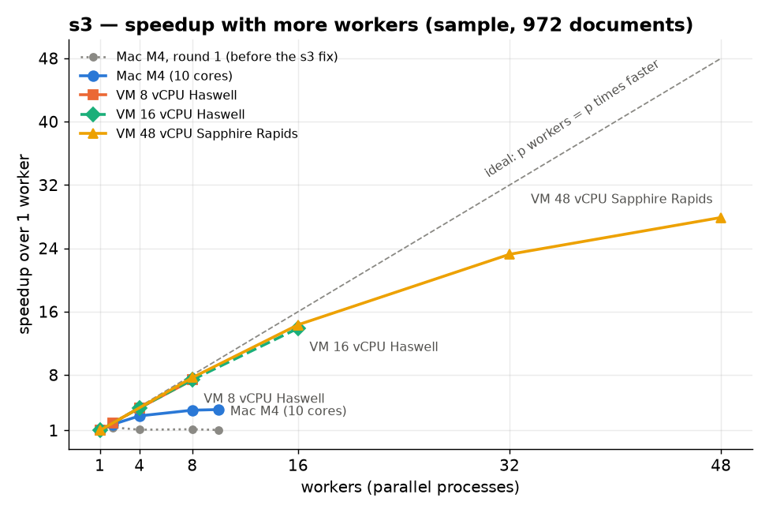

# aifa-rag-cloud

Retrieval-Augmented Generation over the package leaflets (FI) and summaries of product characteristics
(RCP) published by AIFA, the Italian Medicines Agency: ~18,000 PDFs converted to Markdown, split into
~805,000 chunks and indexed in a vector database, with a structured SQLite layer for tabular questions.

University project for the Cloud Computing course of Prof. Massimo Canonico (Università del Piemonte
Orientale). The cloud extension automates the infrastructure as code and compares time and cost of
local vs cloud, CPU vs GPU configurations. The full report, in Italian, is
[docs/RELAZIONE.md](docs/RELAZIONE.md); the case study in English is
[What It Actually Costs to Run a RAG Pipeline](https://www.simonenegro.com/blog/rag-pipeline-cost-local-vs-cloud-gpu).

## Results at a glance

Measurements ran in two rounds; the second one, with the same software versions on every machine, is
the one quoted here.

- **Provisioning as code:** a VM on Chameleon Cloud is reachable in ~70 s with `make lease up`
  (vs ~7 min by hand in the dashboard) and ready for measurements in ~3.5 min; `make down` releases
  everything in ~20 s.
- **PDF → Markdown (s3)** scales almost linearly on cloud VMs (efficiency 0.87 at 16 workers). On an
  Apple M4 it first stopped at 2 workers because of onnxruntime threads; after the fix 10 workers
  match a 16 vCPU VM.
- **Embedding (s4)** on an H100 is ~29× faster than the M4 CPU and ~86× faster than an 8 vCPU VM.
- **Full corpus on one H100 VM:** 2 h 40 min download, 35 min conversion, 2 h 44 min embedding.
  The GPU sits idle 54% of the time. Running conversion on a CPU VM and embedding on the H100 (done
  end to end) costs 8–10% less but takes 63% longer; moving the download too cuts the cost by ~45%.
- **Provider matters more than architecture:** s3 + s4 on the full corpus costs from €11.69 (H100 on
  RunPod) to €32.89 (H100 on Azure).
- **Queries (s5)** answer in 0.27 s on the H100 vs 4.3 s on the M4 GPU, but each costs 4–12× more.
- **EmbeddingGemma 2** instead of bge-m3 indexes the full corpus 2.1× faster and retrieves the right
  drug more often.



## Repository layout

| Path | Content |
|---|---|
| `rag/` | the pipeline: `s1`…`s5` scripts, `config.py`, Streamlit explorer `ui.py` |
| `datasets/` | AIFA open-data CSVs (drug list, active ingredients, ATC codes) |
| `bench/` | benchmark harness: sample creation, instrumented runs, results collection, cost model, charts |
| `infra/` | Terraform for the Chameleon VM (security group, port, instance, floating IP) |
| `Makefile` | VM lifecycle on Chameleon: `lease`, `up`, `deploy`, `bench`, `fetch`, `down`, `ssh` |
| `chameleon/` | `bootstrap.sh` (VM setup), scripts of the original manual full run (baseline v0) |
| `results/` | measurements: one folder per run, plus `all.csv`, `costs.csv`, `costs_split.csv`, `infra_times.csv` |
| `docs/` | report, charts, screenshots of the manual procedure, sources |

Not in the repository (`.gitignore`): `data/` (PDFs, Markdown, Chroma index, ~13 GB), `samples/`,
credentials, Terraform state.

## Pipeline

| Phase | Script | What it does | Bound by |
|---|---|---|---|
| s1 | `s1_structured.py` | CSV → SQLite | disk |
| s2 | `s2_download.py` | async download of FI/RCP PDFs | network (and politeness to AIFA) |
| s3 | `s3_pdf_to_md.py` | PDF → Markdown with PyMuPDF4LLM + Tesseract OCR, multiprocess | CPU |
| s4 | `s4_index.py` | section-aware chunking, bge-m3 embeddings, ChromaDB | GPU |
| s5 | `s5_query.py` | retrieve 30 → rerank with bge-reranker-v2-m3 → top 6 → LLM answer | latency |

### Setup

```bash
uv venv --python 3.13.4 .venv && uv pip install --python .venv -r rag/requirements.txt -c rag/constraints.txt
brew install tesseract tesseract-lang      # macOS; Debian/Ubuntu: apt install tesseract-ocr tesseract-ocr-ita
```

Every machine uses the same Python (3.13.4, installed by [uv](https://docs.astral.sh/uv/)) and the same
library versions: `requirements.txt` pins the direct dependencies, `constraints.txt` the indirect ones.
On a GPU machine install the CUDA build of the pinned PyTorch first, as `chameleon/bootstrap.sh` does.

### Run

```bash
cd rag
export PILOT_N=100                          # number of drugs; 0 = all 12,599 (~25,000 PDFs)
../.venv/bin/python s1_structured.py
../.venv/bin/python s2_download.py
../.venv/bin/python s3_pdf_to_md.py
../.venv/bin/python s4_index.py
../.venv/bin/python s5_query.py "Per cosa si usa la senna? Controindicazioni?"
../.venv/bin/streamlit run ui.py --server.fileWatcherType none
```

s5 answers with Claude by default and needs `ANTHROPIC_API_KEY`. With `LLM_PROVIDER=ollama` it uses a local Ollama model instead. Only the question
and the retrieved chunks leave the machine.

| Variable | Default | Meaning |
|---|---|---|
| `DATA_DIR` | `data/` | where SQLite, PDFs, Markdown and Chroma live |
| `PILOT_N` | `100` | drugs to process (`0` = all) |
| `KEEP_PDF` | `0` | `1` keeps the PDFs after conversion |
| `WORKERS` | all cores | s3 processes |
| `DEVICE` | auto | s4/s5 device: `cuda`, `mps` or `cpu` |
| `EMBED_BATCH` | `64` | s4 model batch size |
| `EMBED_MODEL` | `BAAI/bge-m3` | s4/s5 embedding model; s5 must use the model that built the index |
| `LLM_PROVIDER` / `LLM_MODEL` | `claude` / `claude-opus-4-8` | s5 generator |
| `OLLAMA_MODEL` / `OLLAMA_HOST` | `qwen2.5:7b` / `http://localhost:11434` | s5 with Ollama |

## Benchmarks

Every measurement runs on a fixed sample (the first 500 drugs by code: 972 valid PDFs) in an isolated
folder, so runs never touch `data/` or each other.

```bash
bench/make_sample.sh 500                                     # samples/n500/ + n500.tar.gz (downloads ~1,000 PDFs)
CONFIG=local-cpu-ocr WORKERS=4 bench/run.sh samples/n500 s3  # one phase, 4 workers
CONFIG=local-cpu DEVICE=cpu bench/run.sh samples/n500        # s3 + s4 (s4 needs s3 in the same run)
.venv/bin/python bench/collect.py                            # -> results/all.csv
.venv/bin/python bench/cost_model.py                         # -> results/costs.csv, costs_split.csv
.venv/bin/python bench/charts.py                             # -> docs/charts/*.png
CONFIG=local-mps DEVICE=mps .venv/bin/python bench/s5_bench.py results/<config>/<run_id>/data  # s5 latency and retrieval quality
```

Each run writes `results/<config>/<run_id>/`: `phases.csv` (start, end, seconds, commit, host,
workers, device, batch), one log per phase, and on Linux `vmstat.txt` / `gpu.csv` (one sample per
second). Prices and their sources are in `bench/prices.csv`.

### Embedding map

[docs/embedding-space.html](docs/embedding-space.html) is a single page: every point is a
document (mean of its chunk vectors) in the space of bge-m3 or EmbeddingGemma 2, as a 3D PCA view and a
2D t-SNE view. The buttons at the top pick the corpus (full corpus by default, or the sample) and the
model. Clicking a document shows its 10 nearest documents, next to the s4/s5 numbers of both
models, with a link to its PDF on AIFA and a button that shows its Markdown (`data/md`, from s3) in a
window. The libraries come from a CDN, so it needs internet.

The page can be opened as a file, but then the Markdown window only shows a message: from `file://` the
browser cannot read other files on the disk. To read the texts, serve the page locally with `make map`,
which links `data/md` as `docs/md`, serves `docs/` on `127.0.0.1` only and opens
http://127.0.0.1:8000/embedding-space.html:

```bash
make map                              # local server with the texts; Ctrl-C to stop
open docs/embedding-space.html        # as a file, without the texts (macOS; xdg-open on Linux)
```

To rebuild it, export the vectors of each run's Chroma index, then generate the page. Runs are named
`emb-gpu-<model>` (sample) and `emb-gpu-full-<model>` (full corpus); vectors and indexes are not in the
repository (too large), so this needs the `data/` folder of an s4 run.

```bash
.venv/bin/python bench/emb_export.py results/<config>/<run_id>/data results/<config>/<run_id>/vectors.npz
.venv/bin/python bench/emb_viz.py    # all results/emb-gpu-*/*/vectors.npz -> docs/embedding-space.html
```

EmbeddingGemma 2 (`EMBED_MODEL=google/embeddinggemma-2`) needs newer libraries than `rag/constraints.txt`
(measured with transformers 5.22.1, sentence-transformers 6.2.0, torchvision 0.29.1): use a separate venv.

## Cloud runs on Chameleon

Prerequisites:
- an allocation on Chameleon KVM@TACC and an application credential saved as
  `~/.config/openstack/clouds.yaml`, with the cloud named `chameleon`;
- Terraform, the OpenStack CLI with the Blazar plugin
  (`pipx install python-openstackclient && pipx inject python-openstackclient python-blazarclient`),
  `jq`;
- an SSH key registered on Chameleon as keypair `farmaci-h100` (private key in
  `~/.ssh/chameleon_farmaci`; both can be changed in `Makefile` and `infra/main.tf`).

```bash
make lease up deploy bench     # reserve flavor, create VM, ship code + sample, start the benchmark plan
make ssh                       # optional: tail -f bench.log, the plan ends with BENCH_DONE
make fetch down                # copy results to results/<config>/, destroy VM and lease
```

- The lease is created with the OpenStack CLI (Blazar is not covered by the Terraform provider); the VM,
  its security group, port and floating IP by Terraform.
- Code is shipped as a `git bundle` of the current commit: commit before `make deploy`.
- The benchmark plan is `bench/plan_<config>.sh`. Other configurations:
  `make lease up deploy bench FLAVOR_ID=<flavor id> LEASE_NAME=<name> CONFIG=<config>`
  (flavor ids from `openstack --os-cloud chameleon flavor list`).
- Every target appends its duration to `results/infra_times.csv`.
- A lease consumes Service Units for its whole duration: run `make down` as soon as the plan is done.
- Several VMs can run together: each lease has its own Terraform workspace, so every command for a VM
  must carry its `LEASE_NAME`. The split configuration (s3 on a CPU VM, s4 on the H100, Markdown moved
  with `make fetch-md` and `make push-md`) is described at the top of the `Makefile`.
- `make lease` uses BSD `date -v` (macOS); on Linux replace it with `date -d "+N hours"`.

## Documentation

- [docs/RELAZIONE.md](docs/RELAZIONE.md) — the report (Italian): method, manual vs IaC provisioning,
  results, cost model, limitations.
- [docs/embedding-space.html](docs/embedding-space.html) — interactive map of the embedding space (see above).
- [aifa-drug-research](https://github.com/BeastOfShadow/aifa-drug-research) — the work after the exam (faithful PDF to Markdown conversion, sections, vocabulary, embeddings), moved out of this repo with its history; tag `esame-v1` is the last state with `conv/` here.
- [APPROFONDIMENTO_IAC.md](APPROFONDIMENTO_IAC.md) — the original plan of the cloud extension.
- [LAVORO_SVOLTO.md](LAVORO_SVOLTO.md) — log of the first version (baseline v0).

## License

Code and documentation: [Apache 2.0](LICENSE). You can use, modify and redistribute them, also
commercially, as long as you keep the attribution in [NOTICE](NOTICE) in what you distribute.
If you use this work in a project, an article or a talk, please credit it with a link to this
repository or to [simonenegro.com](https://www.simonenegro.com); [CITATION.cff](CITATION.cff) has the
details (GitHub shows it as "Cite this repository").

The CSV files in `datasets/` and the documents the pipeline downloads are AIFA open data
([aifa.gov.it/liste-dei-farmaci](https://www.aifa.gov.it/it/liste-dei-farmaci)), released under
[CC BY 4.0](https://creativecommons.org/licenses/by/4.0/): source, Agenzia Italiana del Farmaco.
