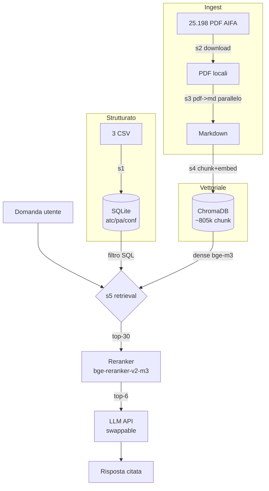
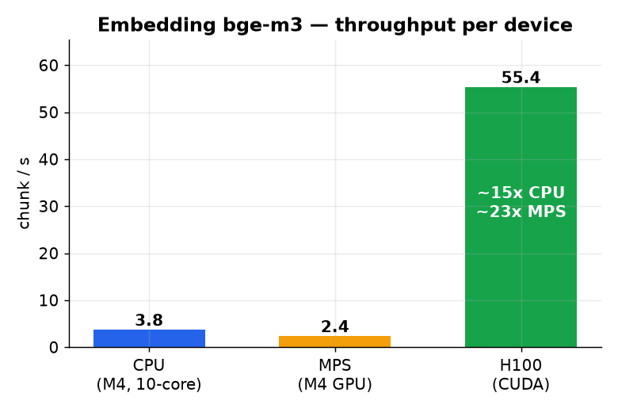
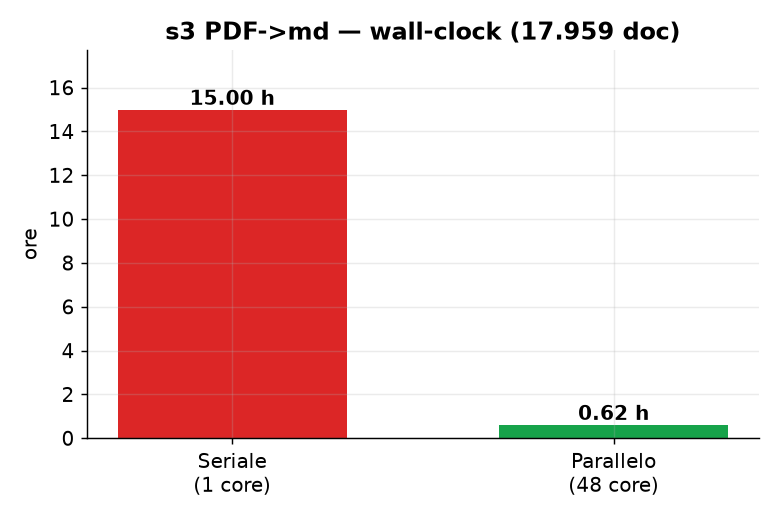
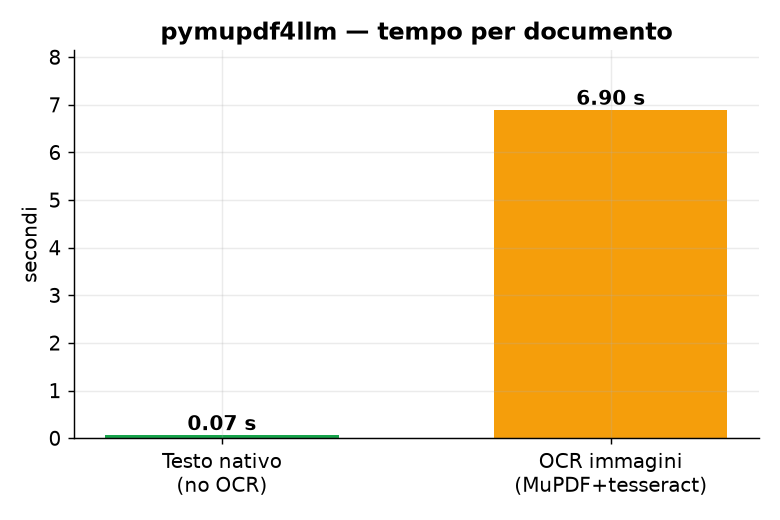
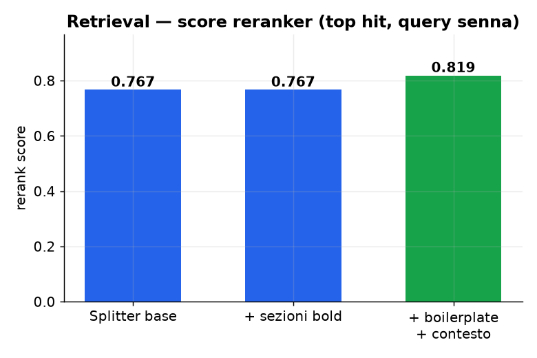
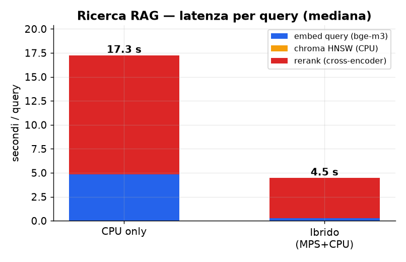

# Costruire un sistema RAG sui foglietti illustrativi AIFA

*Note tecniche complete del progetto — materiale per articolo.*

**Data:** luglio 2026
**Hardware locale:** Mac mini M4 (10-core CPU, GPU integrata, MPS)
**Hardware cloud:** Chameleon Cloud (KVM@TACC) — 1× NVIDIA H100 94 GB, 48 vCPU, 250 GB RAM

---

## 1. Obiettivo

Costruire un sistema di **Retrieval-Augmented Generation (RAG)** sui documenti ufficiali dei farmaci
italiani: Foglietti Illustrativi (FI) e Riassunti delle Caratteristiche del Prodotto (RCP) pubblicati
da AIFA, collegati ai dati anagrafici strutturati (codici ATC, principi attivi, confezioni).

Requisito chiave posto dall'utente: **tutti i dati in locale**, embeddings in locale, solo la
*generazione* delle risposte via API LLM (intercambiabile). Priorità: **massima precisione**, tempo secondario.

---

## 2. I dati di partenza

Tre CSV (separatore `;`, codici con zeri iniziali → letti come stringa):

| File | Righe | Contenuto |
|---|---|---|
| `atc.csv` | 7.209 | Classificazione ATC → descrizione |
| `PA_confezioni.csv` | 337.550 | Principi attivi per confezione (AIC) |
| `confezioni_fornitura.csv` | 159.708 | Anagrafica confezioni + link ai PDF FI/RCP |

**Osservazione decisiva:** 159.708 righe ma solo **12.599 farmaci unici** (`COD_FARMACO`). I link FI/RCP
sono per-farmaco → dedup porta da ~320.000 a **25.198 PDF** (12.599 FI + 12.599 RCP). Risparmio del 92%.

Chiavi di join:
- `conf.CODICE_ATC` → `atc.CODICE_ATC` (100% match)
- `pa.CODICE_AIC` ↔ `conf.CODICE_AIC`
- `conf.COD_FARMACO` → identifica il PDF

---

## 3. Architettura: ibrida, non RAG puro

La scelta progettuale più importante: **i dati tabellari NON vanno in RAG.** Query esatte ("che ATC ha
il farmaco X", "confezioni della ditta Y") si risolvono in SQL — deterministico, istantaneo, zero
allucinazioni. Il RAG serve solo per il **testo libero** dei foglietti.



Due layer:
1. **Strutturato** — SQLite con indici sulle chiavi. SQL puro.
2. **Vettoriale** — ChromaDB. Chunk dei md → embedding bge-m3.

Collante: ogni chunk porta nei metadati `cod_farmaco`, `tipo` (FI/RCP), `section`, `denominazione`,
`codice_atc`, `ragione_sociale` → filtro strutturato + join.

---

## 4. La pipeline

| Step | Script | Funzione |
|---|---|---|
| s1 | `s1_structured.py` | 3 CSV → SQLite + indici |
| s2 | `s2_download.py` | Download 25.198 PDF (async, cache, retry, rate-limit) |
| s3 | `s3_pdf_to_md.py` | PDF → Markdown **parallelo su 48 core** (OCR immagini incluso) |
| s4 | `s4_index.py` | Chunk per sezione → embed bge-m3 (GPU) → ChromaDB |
| s5 | `s5_query.py` | Retrieval 2-stadi + generazione LLM |
| — | `report_missing.py` | CSV dei documenti mancanti (404/500/scansioni) |

### Chunking per sezione

I documenti AIFA hanno sezioni standard, ma pymupdf4llm le rende come **marcatori grassetto inline**
(`**4.3 Controindicazioni**`), non come heading di riga. Lo splitter iniziale (basato su heading
markdown) catturava spazzatura. Riscritto per segmentare sui marcatori numerati → sezioni pulite:

- **RCP**: 1 Denominazione, 2 Composizione, 3 Forma, 4.1 Indicazioni, 4.2 Posologia, 4.3 Controindicazioni, 4.8 Effetti indesiderati, ...
- **FI**: 1 Cos'è, 2 Cosa sapere prima, 3 Come usare, 4 Effetti indesiderati, 5 Conservazione

### Due miglioramenti alla qualità

1. **Strip boilerplate AIFA** — il footer legale ("Documento reso disponibile da AIFA il...", "Esula
   dalla competenza dell'AIFA...") si ripete in ogni doc. Rimosso al 99% via regex prima del chunking.
2. **Prefisso di contesto nell'embedding** — ogni chunk viene embeddato come
   `{denominazione} — {tipo} — {sezione}: {testo}`, mentre il documento memorizzato resta il testo raw.
   L'embedding cattura così farmaco + sezione → matching più preciso.

### Retrieval a 2 stadi

```
domanda → dense bge-m3 → top-30 candidati (recall largo)
                              ↓
          cross-encoder bge-reranker-v2-m3 → top-6 (precisione)
```

---

## 5. Stack tecnologico

| Componente | Scelta | Perché |
|---|---|---|
| Strutturato | **SQLite** | stdlib, file-based, zero server |
| PDF → md | **pymupdf4llm** | testo nativo fedele + struttura markdown |
| Embedding | **BAAI/bge-m3** (fp32) | multilingua, long-context, ottimo su italiano/medico |
| Reranker | **BAAI/bge-reranker-v2-m3** | cross-encoder, coppia di bge-m3 |
| Vector DB | **ChromaDB** | locale, persistente |
| Generazione | provider astratto (Claude / Ollama) | swappable, dati restano locali |

---

## 6. Benchmark

### Embedding: la GPU è d'obbligo

Test su bge-m3, batch da 256 chunk:



| Device | s / batch (256) | chunk/s | note |
|---|---|---|---|
| CPU M4 (10-core) | ~68 s | 3.8 | |
| **MPS (GPU M4)** | ~106 s | 2.4 | **più lento della CPU!** |
| H100 (CUDA) | ~4.6 s | 55.4 | ~15× CPU |

**Sorpresa:** su M4 base, MPS è più *lento* della CPU per bge-m3 (GPU a 10 core + fallback di operazioni
non supportate su MPS che rimbalzano GPU↔CPU). Su un modello transformer grande, la CPU M4 vince.
La H100 chiude il discorso: ~15× la CPU.

Sull'intero corpus: **~805.000 chunk** embeddati in ~2,5 h su H100 (sarebbero state ~50 h su CPU).

### s3 PDF → md: parallelizzare cambia tutto



Seriale su 1 core: ~15 h stimate per 17.959 documenti. Parallelizzato su 48 core (multiprocessing):
**37 minuti reali** (~9,5 md/s). ~24× di wall-clock.

### L'inciampo OCR di pymupdf4llm



Vedi §7.5. Un documento nativo si estrae in 0,07 s; con l'OCR-immagini di MuPDF attivo, 6,9 s. ×100.

### Qualità del retrieval



Score del reranker sul top hit (query: "controindicazioni ed effetti della senna"): da 0,767 a **0,819**
dopo splitter per sezione + strip boilerplate + prefisso di contesto.

### Ricerca RAG (query): qui la GPU vince

Contro-prova del §7.4: nell'*embedding a batch* MPS è più lento della CPU, ma nella **ricerca
interattiva** (latenza, non throughput) è l'opposto — MPS domina. Misurato su Mac mini M4, indice
completo (**804.995 chunk**), 8 query mediche in italiano, 3 ripetizioni, mediana. `RETRIEVE_N=30`,
`TOP_K=6`. I due modelli neurali (bge-m3 + reranker) girano sul device scelto; ChromaDB HNSW resta
sempre su CPU.



| Stadio (mediana / query) | CPU only | Ibrido (MPS+CPU) | Speedup |
|---|---|---|---|
| Embed query (bge-m3) | 4.817 s | 0.265 s | **18×** |
| Chroma HNSW (sempre CPU) | 15 ms | 6 ms | ~1× (rumore) |
| Rerank 30 cand. (cross-encoder) | 12.429 s | 4.199 s | **3.0×** |
| **Totale per query** | **17.65 s** | **4.47 s** | **3.9×** |

- **Range latenza:** CPU 5.1–25.3 s, ibrido 2.6–7.6 s.
- **Cold load (una tantum):** CPU 7.3 s, MPS 11.0 s — MPS carica più lento (init grafi/transfer), poi
  ammortizzato su ogni query.
- **Il rerank è il collo di bottiglia:** 70% del tempo su CPU, 94% sull'ibrido. Scoring cross-encoder di
  30 coppie query-documento = il carico neurale pesante → è lì che la GPU rende. L'embed della query
  (1 frase) è leggero ma comunque 18× su MPS.
- **Chroma HNSW è irrilevante:** ≤15 ms in entrambi, gira su CPU a prescindere. Il match vettoriale su
  805k chunk non è il problema; lo sono i due transformer.

**Conclusione operativa:** per servire query in locale, l'ibrido MPS+CPU (default `pick_device()`) taglia
la latenza ~4×. La regola "MPS lento" del §7.4 vale solo per il throughput a batch grandi dell'indicizzazione,
non per la latenza a batch=1 del retrieval.

---

## 7. Inciampi tecnici (il bello dell'articolo)

### 7.1 venv cross-progetto e kernel Jupyter
Un venv di un altro progetto è usabile come kernel, ma VSCode auto-scopre solo i venv nel workspace. Lezione: venv dedicato in `.venv` nella root → auto-scoperto sempre.

### 7.2 CSV con zeri iniziali
`CODICE_AIC` come `000152037`: va letto `dtype=str`, altrimenti pandas droppa gli zeri e le chiavi non fanno più join.

### 7.3 torch: CUDA della wheel vs driver
`pip install torch` di default ha preso la wheel **cu130** (CUDA 13). Driver del nodo: 560.35.05 = CUDA 12.6 → `torch.cuda.is_available() == False`, "driver too old". Fix: installare la wheel **cu124** dall'index PyTorch. Su Linux la wheel porta il runtime CUDA; serve solo il driver compatibile.

### 7.4 MPS più lento della CPU
Contro-intuitivo ma misurato (§6). Su Apple Silicon base, per modelli grandi conviene testare CPU vs MPS invece di dare per scontata la GPU.
**Ma dipende dal regime:** vale per il *throughput* dell'embedding a batch 256 (indicizzazione). Per la
*latenza* del retrieval (batch=1, §6 "Ricerca RAG") MPS è invece ~4× più veloce della CPU. Non esiste un
verdetto unico device: misura per fase.

### 7.5 pymupdf4llm che OCR-a da solo → 15 h
Il problema più insidioso. In locale pymupdf4llm era velocissimo; sul nodo, **6,9 s/doc**. Causa: avevo
installato `tesseract-ocr` (per un OCR mirato). Con tesseract presente, **MuPDF OCR-a automaticamente le
pagine-immagine** di ogni PDF (loghi, watermark). In locale, senza tessdata, l'OCR non partiva → veloce.
Né i flag di pymupdf4llm né `TESSDATA_PREFIX` lo disattivano.
**Decisione:** invece di combatterlo, tenerlo (le immagini vanno comunque nel RAG) e **parallelizzare** →
da 15 h a 37 min. MuPDF OCR-a sia le pagine-immagine sia i documenti interamente scansionati → niente
tool OCR separato.

### 7.6 Collisione `import datasets`
La cartella del progetto `datasets/` ombreggiava il pacchetto HuggingFace `datasets` quando si lanciava
Python dalla root. Fix: eseguire gli script da `rag/`, path dei CSV assoluti.

### 7.7 setsid e la SSH che si chiude
Il run lanciato con `setsid` sopravvive alla chiusura della SSH. Un exit 255 della SSH di lancio non
significa che il run è morto — verificato via albero processi (l'orchestrator resta session leader).

---

## 8. Il dataset dei documenti

Sui 25.198 PDF tentati:

- **~17.959 documenti** scaricati e convertiti in markdown
- **~7.000 codici 404**: farmaci senza FI/RCP pubblicati (ritirati/mai caricati) — attesi
- **58 errori 500**: transitori, recuperabili con re-run resumable

Tutti i mancanti sono tracciati in `missing.csv` (farmaco, tipo, denominazione, ATC, ditta, motivo, url).

Indice finale: **~805.000 chunk** in ChromaDB.

---

## 9. Riproducibilità

**Locale (pilot):**
```bash
python3 -m venv .venv && . .venv/bin/activate
pip install -r rag/requirements.txt
cd rag
python s1_structured.py
PILOT_N=100 python s2_download.py
python s3_pdf_to_md.py
python s4_index.py
python s5_query.py "controindicazioni della senna?"
```

**Full run su GPU (Chameleon H100):**
```bash
bash chameleon/bootstrap.sh          # deps + torch cu124 + verifica CUDA
export PILOT_N=0 EMBED_BATCH=256
python s1_structured.py
python s2_download.py                # ~25k PDF
python s3_pdf_to_md.py               # parallelo su 48 core
python s4_index.py                   # embed su H100
python report_missing.py
```

Poi rsync dei risultati (`data/chroma`, `data/md`, `data/farmaci.sqlite`, `data/missing.csv`) in locale;
le query girano offline sul Mac (retrieval leggero, solo la generazione chiama l'API).

---

## 10. Screenshot da inserire (già catturati)

> *Sostituire i placeholder con le immagini reali.*

- `` — selezione kernel/venv
- `` — conversione parallela con messaggi Tesseract
- `` — lease H100 attivo
- `` — barre tqdm

---

## 11. Lezioni chiave

1. **RAG ibrido**: SQL per lo strutturato, vettoriale per il testo. Non forzare tutto negli embeddings.
2. **Chunk per sezione** dei documenti regolatori: la struttura standard (RCP/FI) è oro per il retrieval.
3. **Misura l'hardware**: MPS non è sempre più veloce della CPU; la wheel CUDA deve combaciare col driver.
4. **Diffida dei default silenziosi**: pymupdf4llm che OCR-a da solo ha 30× il tempo di conversione.
5. **Parallelizza il CPU-bound, GPU per gli embeddings**: ogni fase sull'hardware giusto.
6. **Traccia i buchi**: `missing.csv` rende onesto e riproducibile il corpus.
