# Infrastructure as Code e confronto costi/prestazioni per una pipeline RAG sui documenti AIFA

**Simone Negro** — matricola 20051767 — Università del Piemonte Orientale
Progetto per il corso del prof. Massimo Canonico — 30/10/2026

---

## Sommario

Il progetto parte da una pipeline RAG (*Retrieval-Augmented Generation*) costruita sui Foglietti Illustrativi (FI) e sui Riassunti delle Caratteristiche del Prodotto (RCP) pubblicati da AIFA. La pipeline converte circa 18.000 documenti da PDF a Markdown, li divide in circa 805.000 frammenti e li indicizza in un database vettoriale. Una prima versione ha eseguito l'elaborazione su una VM di Chameleon Cloud con GPU H100, configurata a mano. Questa relazione descrive l'estensione concordata di rendere il provisioning riproducibile come codice (*infrastructure as code*) e, in seguito, di confrontare tempi e costi di configurazioni diverse, locali e cloud, con e senza GPU.

I risultati principali sono:
- con Terraform e un Makefile la VM è raggiungibile in **~70 secondi**, contro i ~7 minuti della procedura manuale dalla dashboard di Chameleon Cloud. La VM è pronta per le misure in **~5 minuti**, mentre la distruzione (~20 s) rilascia tutte le risorse, compreso l'IP pubblico che a mano era stato dimenticato (§5);
- la conversione dei file da PDF a Markdown (fase s3) scala quasi linearmente sulle VM cloud (efficienza 0,92 con 8 worker), mentre sul Mac si ferma a 2 worker (§7.1–7.2);
- l'embedding (fase s4) sulla H100 è ~30 volte più veloce della CPU del Mac e 51–88 volte più veloce delle VM da 16 e 8 vCPU: per il corpus completo servono 2 h 44 min contro giorni (§7.3);
- nella configurazione monolitica la GPU resta inutilizzata per il **54%** del tempo pagato (download e conversione), argomento che va a favore della configurazione eterogenea (§7.4);
- il campione fisso **sottostima** il corpus completo del 25% (s3) e del 36% (s4), perché i suoi documenti hanno frammenti più corti (§7.5);
- separare le fasi (s3 su una VM solo CPU, s4 sulla GPU) riduce il costo di s3 + s4 sul corpus completo del 10–12%, al prezzo di un tempo maggiore del 46%. Inoltre, spostando anche il download sulla VM CPU il risparmio sale al 45–47% (§7.6);
- il fornitore pesa più dell'architettura: s3 + s4 sul corpus completo costano da 11,77 € (H100 su RunPod) a 33,10 € (H100 su Azure) (§7.6);
- l'overhead fisso di ~5 minuti aumenta del 78% il costo di un run sul campione con la H100 e del 2,4% quello sul corpus completo. In tempo, il cloud batte il Mac già sopra ~30 documenti, mentre riguardo al costo in euro, il Mac resta più economico a ogni dimensione, con lo svantaggio che il corpus completo gli richiederebbe ~3,7 giorni (§7.7).

---

## 1. Introduzione e obiettivi

Nella prima versione del progetto il cloud era usato come semplice potenza di calcolo a noleggio: la VM veniva prenotata dalla dashboard, configurata via SSH con uno script e rilasciata a mano. Su indicazione del docente (scambio email del 28/09–14/10/2026), tra le tre estensioni proposte è stata scelta la terza:

> automatizzare il provisioning dell'infrastruttura (infrastructure as code) e confrontare costi e prestazioni di diverse configurazioni (solo CPU, GPU, locale e cloud).

Domande di ricerca:

1. **Quanto costa rendere l'infrastruttura riproducibile?** Si misura il tempo dal comando di provisioning alla VM pronta e lo si confronta con la durata del lavoro utile.
2. **Qual è la configurazione migliore per ciascuna fase?** Le fasi della pipeline hanno profili di carico diversi (rete, CPU, GPU).
3. **Una VM unica è uno spreco?** Si confrontano la configurazione monolitica (una VM GPU per tutto) e quella eterogenea (una VM CPU per la conversione, una VM GPU solo per l'embedding).
4. **Quando conviene il cloud rispetto alla macchina locale?** Si calcola il punto di pareggio in funzione della dimensione del corpus.
5. **Come scala la conversione da PDF a Markdown con il numero di core?** Si misura il tempo con 1, 2, 4... worker, fino a tutti i core disponibili.

---

## 2. Contesto: dati e pipeline

### 2.1 Dati

Il 09/07/2026 ho scaricato tre file CSV dalla sezione *Liste dei farmaci* (paragrafo *Anagrafica dei farmaci*) degli open data AIFA [1]:

| File | Righe | Contenuto |
|---|---|---|
| `atc.csv` | 7.209 | Classificazione ATC e relativa descrizione |
| `PA_confezioni.csv` | 337.550 | Principi attivi per confezione (codice AIC) |
| `confezioni_fornitura.csv` | 159.708 | Anagrafica confezioni, con i link ai PDF di FI e RCP |

Le 159.708 confezioni corrispondono a 12.599 farmaci distinti (`COD_FARMACO`). I PDF però sono per farmaco, non per confezione. Raggruppando per farmaco, i link da scaricare passano da circa 320.000 a 25.198 (un FI e un RCP per farmaco). Di questi, circa 18.000 sono disponibili (17.959 nella baseline, 17.984 nel full run del 28/10/2026); gli altri rispondono con errore 404 (non pubblicati) o 500 (errore del server).

### 2.2 Pipeline

La pipeline è un RAG [2]: per rispondere a una domanda cerca nei documenti i passaggi più pertinenti e li passa a un modello linguistico, che risponde basandosi su quelli. È *ibrido* perché le domande sui dati tabellari (per esempio "quali farmaci contengono il principio attivo X") si risolvono in SQL su SQLite, mentre il testo dei documenti è indicizzato in un database vettoriale (ChromaDB [9]). 

La pipeline è composta da cinque fasi distinte:

| Fase | Script | Cosa fa | Risorsa limitante |
|---|---|---|---|
| s1 | `s1_structured.py` | conversione da CSV a SQLite con indici | disco (pochi secondi) |
| s2 | `s2_download.py` | download asincrono dei PDF, elenco dei file in SQLite | rete, limite di richieste per non sovraccaricare AIFA |
| s3 | `s3_pdf_to_md.py` | conversione da PDF a Markdown con PyMuPDF4LLM [7] e OCR Tesseract [8], in parallelo | CPU |
| s4 | `s4_index.py` | divisione in frammenti (chunking) per sezione, embedding con bge-m3 [3], indicizzazione | GPU |
| s5 | `s5_query.py` | ricerca di 30 frammenti candidati → riordino con bge-reranker-v2-m3 [4], ne restano 6 → risposta del modello linguistico | latenza |

Di seguito elenco le varie fasi spiegate nel dettaglio, mentre per il diario completo della prima versione si può leggere [LAVORO_SVOLTO.md](../LAVORO_SVOLTO.md).

#### 2.2.1 s1, dati strutturati

Nella prima fase carico i tre CSV in dati strutturati all'interno di SQLite, andando a leggere tutte le colonne come testo. Questo perché i codici AIC hanno degli zeri iniziali (`000152037`) e, se andassi a leggerli come numeri, gli zeri sparirebbero e farebbero fallire i collegamenti tra le tabelle.

#### 2.2.2 s2, download

In seguito scarico i PDF in parallelo, ma con al massimo 6 richieste alla volta per non sovraccaricare i server AIFA (altrimenti il server potrebbe rispondere con un timeout per le troppe richieste effettuate in poco tempo), e ritento fino a 3 volte in caso di errore. L'esito di ogni download (riuscito, 404, 500) finisce in una tabella SQLite, in modo da tenere traccia di quali farmaci abbiano dato errore e da far ripartire un run interrotto da dove si era fermato, sapendo quali documenti mancano e perché.

#### 2.2.3 s3, conversione

Nella fase di conversione, PyMuPDF4LLM trasforma ogni PDF in Markdown mantenendo titoli, elenchi e tabelle, e passa all'OCR le pagine che in realtà sono immagini (per esempio i documenti scansionati, in modo da non perderne il contenuto). Siccome i documenti sono indipendenti tra loro, li converto in parallelo su più processi (*worker*), in modo da velocizzare il processo di conversione. Alla fine della conversione, cancello il PDF e tengo solo il Markdown (~1 GB in tutto). Ho deciso di cancellare i PDF perché avrebbero occupato spazio inutile, siccome ho lo stesso documento convertito in MD. Ho deciso di convertire tutti i PDF perché i file MD sono di più facile lettura, interpretazione e possibile modifica. Inoltre gli LLM fanno meno fatica a estrarre informazioni da un testo in Markdown, e i titoli che il Markdown conserva servono in s4 per dividere i documenti per sezione. Questa scelta è stata fatta anche in vista di un possibile ampliamento del progetto.

#### 2.2.4 s4, indicizzazione

Durante l'indicizzazione ho deciso di togliere il testo legale che AIFA ripete in ogni documento, tenendo solo i dati strettamente necessari. Essendo uguale in tutti i documenti, quel testo li farebbe sembrare simili tra loro e peggiorerebbe la ricerca. La pulizia avviene in memoria, quindi i file MD restano invariati. Poi divido ciascun documento in frammenti (*chunk*) seguendo le sezioni numerate standard di FI e RCP (per esempio "4.3 Controindicazioni"). Le sezioni più lunghe di 1.800 caratteri vengono spezzate con 150 caratteri di sovrapposizione. Prima di calcolare l'embedding aggiungo a ogni frammento il nome del farmaco, il tipo di documento e la sezione, così il vettore "sa" a cosa si riferisce. In ChromaDB ogni frammento è salvato con il suo vettore e con i metadati (codice del farmaco, ATC, ditta), che collegano i due livelli e permettono di filtrare la ricerca.

#### 2.2.5 s5, interrogazione

Infine c'è la fase di interrogazione, in cui la domanda diventa un vettore con lo stesso modello usato in s4 e vengono recuperati i 30 frammenti più vicini. Un secondo modello (*reranker*), più lento ma più preciso, rilegge ogni coppia domanda–frammento e tiene i 6 migliori. Questi passano al modello linguistico (Claude, oppure un modello locale con Ollama) che si occuperà di rispondere solo in base ai frammenti, dicendo se l'informazione manca e citando sempre il farmaco da cui la prende.

---

## 3. Baseline v0: run manuale su Chameleon Cloud

Chameleon [5] è un testbed per la ricerca sui sistemi cloud basato su OpenStack. Le risorse si
ottengono tramite *lease* (prenotazioni a tempo), che hanno una durata scelta dall'utente. Ho eseguito la baseline sul sito KVM@TACC, creando le risorse a mano dalla dashboard web.

Nel dettaglio:
- VM con 1 GPU NVIDIA H100 (94 GB), 48 vCPU, 250 GB di RAM, Ubuntu 22.04;
- lease e istanza creati dalla dashboard, configurazione con `chameleon/bootstrap.sh` via SSH;
- run completo con `chameleon/run_full.sh`, risultati riportati in locale con `rsync`.

Risultati (commit `93b93de`, tag `baseline-v0`):

| Fase | Cloud (H100 + 48 vCPU) | Note |
|---|---|---|
| s3, 17.959 documenti | 37 min | 48 processi paralleli, OCR attivo |
| s4, 804.995 chunk | ~2,5 h | batch 256; durata osservata, non misurata in modo controllato |
| s5, latenza per domanda | — | eseguita in locale: ~4,5 s con MPS, ~17,7 s su sola CPU |

Limiti di questa versione, che motivano l'estensione:
- provisioning manuale e non versionato;
- una sola configurazione misurata, quindi nessun confronto;
- nessuna stima dei costi;
- risorse inutilizzate: la H100 resta ferma durante s3, i 48 vCPU quasi inattivi durante s4;
- tempi in parte stimati o ricavati da un singolo batch.

---

## 4. Metodologia

In questo capitolo descrivo come ho impostato le misure, cioè quali configurazioni ho confrontato, su quali dati le ho eseguite, come ho registrato i tempi e quante volte ho ripetuto ogni misura.

### 4.1 Configurazioni

Una configurazione è la combinazione di macchina e dispositivo su cui eseguo la pipeline. Le ho scelte per coprire i casi richiesti dall'estensione, cioè locale e cloud, solo CPU e con GPU. In locale uso il mio Mac mini, mentre sul cloud uso tre VM di Chameleon di dimensione crescente. L'ID di ogni configurazione è lo stesso che compare nella cartella dei risultati (`results/<config>/`) e nelle tabelle del capitolo 7.

| ID | Dove | Risorse |
|---|---|---|
| `local-cpu` | Mac mini M4 (2024) | CPU 10 core (4 performance + 6 efficiency), 16 GB; s3 senza OCR |
| `local-cpu-ocr` | Mac mini M4 (2024) | come sopra, s3 con OCR (Tesseract installato) |
| `local-mps` | Mac mini M4 (2024) | GPU integrata 10 core via Metal (MPS) |
| `cloud-cpu-s` | Chameleon KVM@TACC, flavor `m1.xlarge` | 8 vCPU Intel Haswell, 16 GB |
| `cloud-cpu-l` | Chameleon KVM@TACC, flavor `m1.xxlarge` | 16 vCPU Intel Haswell, 32 GB; creata con l'IaC |
| `cloud-gpu` | Chameleon KVM@TACC, flavor `g1.h100.pci.1` | 1× H100 94 GB, 48 vCPU Xeon Platinum 8468, 250 GB |
| `cloud-gpu-full` | come `cloud-gpu` | corpus completo, una esecuzione |
| `cloud-split` | `cloud-cpu-l` per s3 + `cloud-gpu` per s4 | calcolata dai tempi per fase, non eseguita (§7.6) |

Nel piano iniziale avevo previsto 48 vCPU per `cloud-cpu-l`, ma su KVM@TACC il flavor con solo CPU più grande è `m1.xxlarge`, che ne ha 16 (§5.1). Lo scaling di s3 fino a 48 processi è stato misurato sulla VM GPU, che ha 48 vCPU ma un processore diverso (§7.2, §9).

### 4.2 Campione fisso

Ripetere più volte la pipeline sul corpus completo per ogni configurazione non è sostenibile, perché richiederebbe oltre 80 h di sola indicizzazione sulla CPU locale (§7.7) e ogni run ricontatterebbe AIFA per 25.000 download. Per questo ho deciso di usare un **campione fisso**, creato una volta con `bench/make_sample.sh 500`:
- i primi 500 farmaci in ordine di `COD_FARMACO` (ordinamento esplicito, quindi campione stabile);
- 1.000 PDF richiesti, **972 validi**, che producono **31.905 chunk** senza OCR e **31.365** con OCR (§9);
- archiviato come `samples/n500.tar.gz` (SQLite con il manifest + PDF, 294 MB) e copiato su ogni VM (§5.3).

All'inizio pensavo di poter ricavare i tempi del corpus completo da quelli del campione con una semplice proporzione, in base al numero di documenti per s3 e al numero di chunk per s4. Il full run del 28/10 mi ha permesso di verificarlo, e la proporzione **sottostima** i tempi reali del 25–36% perché i documenti del campione sono più brevi di quelli del resto del corpus (§7.5).

### 4.3 Strumentazione

Ogni misura è un run di `bench/run.sh`, che:
1. crea una cartella `results/<config>/<run_id>/` con una copia del database del campione e un collegamento in sola lettura ai PDF, così ogni run parte dallo stesso stato e non tocca i dati della baseline;
2. esegue le fasi richieste registrando inizio, fine e durata in `phases.csv`, insieme a commit, host, numero di CPU, worker, device e dimensione del batch;
3. su Linux registra in background l'utilizzo di CPU (`vmstat`, ogni secondo) e GPU (`nvidia-smi`, ogni secondo).

`bench/collect.py` unisce tutti i run in `results/all.csv`, aggiungendo campione, documenti convertiti e chunk indicizzati letti dalla cartella di ogni run. I tempi di infrastruttura (lease, creazione, configurazione, distruzione) sono scritti dal Makefile in `results/infra_times.csv` (§5.4).

### 4.4 Protocollo

Per ottenere i dati, ho eseguito il seguente protocollo:
- 3 ripetizioni per misura, si riporta la mediana e lo scarto (massimo − minimo) in percentuale della mediana; le eccezioni (misure singole) sono indicate;
- commit registrato in ogni riga di `phases.csv`;
- versioni bloccate in `rag/requirements.txt`; l'interprete e PyTorch dipendono dalla macchina: Python 3.13.4 e PyTorch 2.13.0 in locale, Python 3.12.3 e PyTorch 2.14.1 su `cloud-cpu-s` e `cloud-gpu` (build CPU e CUDA 12.6), PyTorch 2.15.0 su `cloud-cpu-l` (§9);
- macchina locale con la sospensione di sistema disattivata (`caffeinate -i`);
- s4 su CPU e su MPS misurata con una sola ripetizione per la durata (da 2,4 h a 6,9 h); per run così lunghi la variabilità relativa attesa è bassa, e sulle VM cloud lo scarto tra ripetizioni è rimasto sotto l'1% per s4 (§7.3).

---

## 5. Provisioning: dalla procedura manuale all'infrastruttura come codice

In questo capitolo racconto come ho creato le VM su Chameleon, prima a mano dalla dashboard e poi con l'infrastruttura come codice. Con infrastruttura come codice si intende descrivere le risorse cloud in file di testo versionati, che un comando trasforma in risorse reali al posto dei clic sulla dashboard. In questo modo la stessa VM si può ricreare identica tutte le volte che serve, e distruggere senza dimenticare niente.

Per prima cosa descrivo le risorse disponibili sul sito KVM@TACC, poi la procedura manuale con i tempi che ho rilevato e il modo in cui ho portato codice e dati sulla VM e i risultati indietro. Infine spiego come ho automatizzato l'intero ciclo di vita della VM con Terraform e un Makefile, e confronto i tempi delle due procedure.

### 5.1 Risorse su Chameleon KVM@TACC

Le misure cloud usano il progetto Chameleon *BioG-LLM* (CHI-261565), con un'allocazione di 20.000 *Service Unit* (SU) valida fino al 26/01/2027 (screenshot in §5.2). Su KVM@TACC ogni istanza richiede un lease di Blazar [15], il servizio di prenotazione di OpenStack, che prenota un *flavor*, cioè un tipo di VM con un numero fisso di vCPU, una quantità di RAM ed eventualmente una GPU. Quando il lease diventa `ACTIVE` compare un flavor dedicato chiamato `reservation:<id>`, il cui id coincide con quello della prenotazione. Le SU si consumano per tutta la durata del lease, non solo mentre la VM lavora: conviene quindi cancellarlo appena finite le misure.

Flavor disponibili rilevanti:

| Flavor | vCPU | RAM | Acceleratore | Uso |
|---|---|---|---|---|
| `m1.xlarge` | 8 | 16 GB | — | `cloud-cpu-s` |
| `m1.xxlarge` | 16 | 32 GB | — | `cloud-cpu-l` (il più grande solo CPU) |
| `g1.h100.pci.1` | 48 | 250 GB | 1× H100 | `cloud-gpu` |
| `g1.h100.vgpu.1g.12gb` | 6 | 36 GB | 1/7 di H100 (12 GB) | non usato |

### 5.2 Procedura manuale

Le VM `cloud-cpu-s` (26/10/2026) e `cloud-gpu` (28/10/2026) sono state create dalla dashboard
(OpenStack Horizon), documentando ogni passo con uno screenshot. Negli screenshot le risorse di altri membri del progetto sono coperte in grigio.

**1. Progetto e allocazione.** Si seleziona il progetto con un'allocazione attiva. Il progetto del corso non ha un'allocazione e quindi non permette di creare risorse.

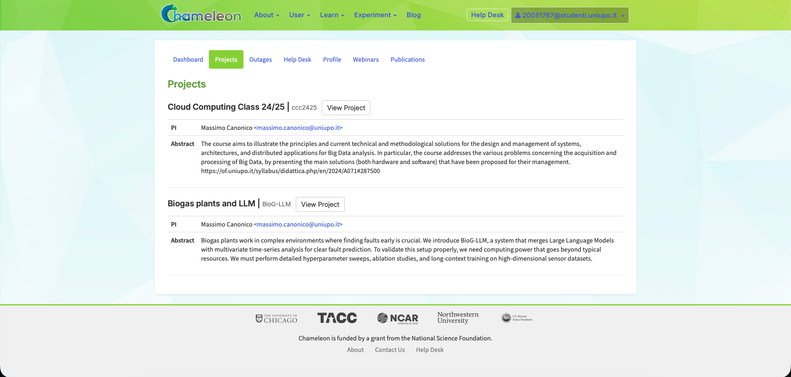
*Elenco dei progetti a cui ho accesso.*

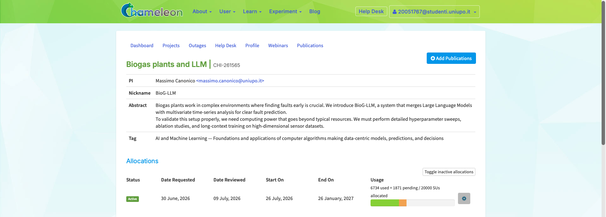
*L'allocazione del progetto BioG-LLM, con 20.000 SU fino al 26/01/2027.*

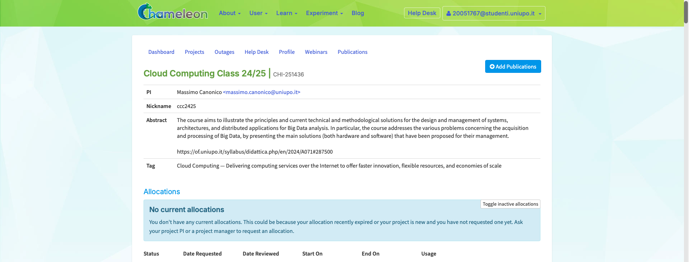
*Il progetto del corso, senza allocazione.*

**2. Accesso.** Servono una coppia di chiavi SSH e un security group con la porta 22 aperta.

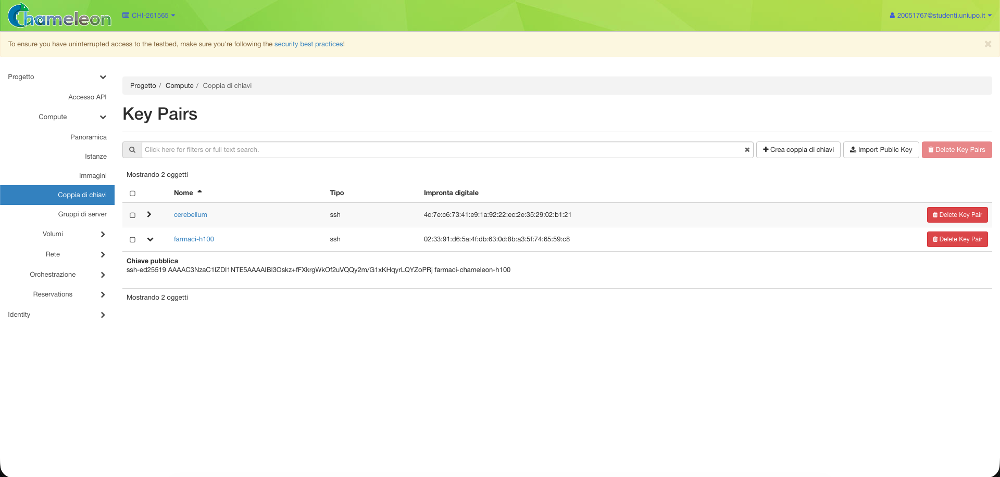
*La coppia di chiavi SSH registrata su Chameleon.*

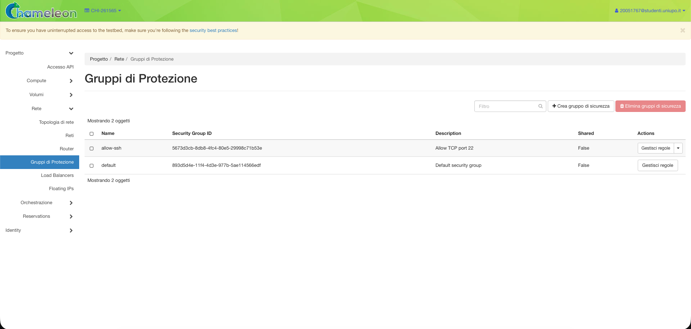
*Il security group con la regola per la porta 22.*

**3. Lease.** Per la H100 si controlla prima la disponibilità nel calendario dei flavor, poi si crea il lease con *Create Lease* scegliendo il flavor, senza prenotare reti. Il lease resta in `PENDING` finché non arriva l'ora di inizio, poi diventa `ACTIVE`.

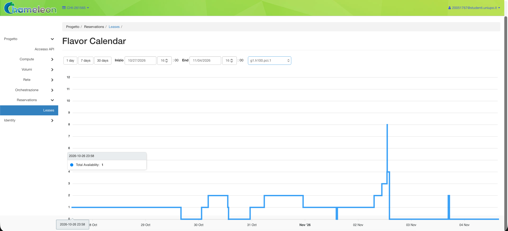
*Il calendario di disponibilità delle H100, da controllare prima di prenotare.*

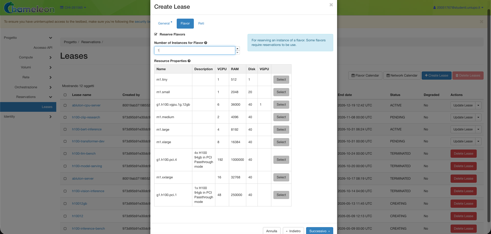
*Creazione del lease, scheda del flavor.*

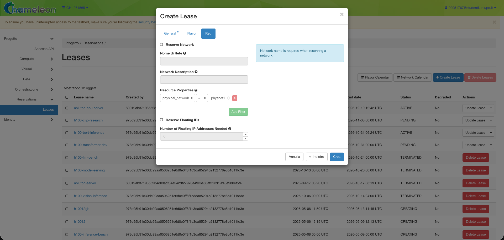
*Creazione del lease, scheda delle reti, lasciata vuota.*

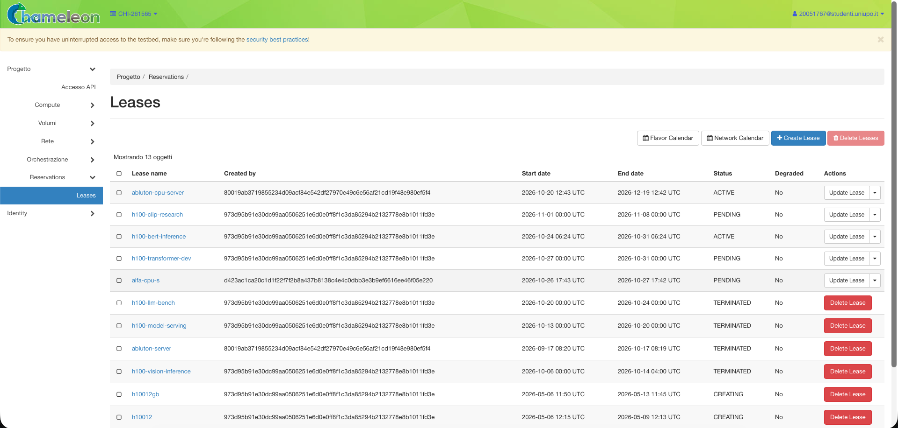
*Il lease della VM `cloud-cpu-s` in attesa dell'ora di inizio.*

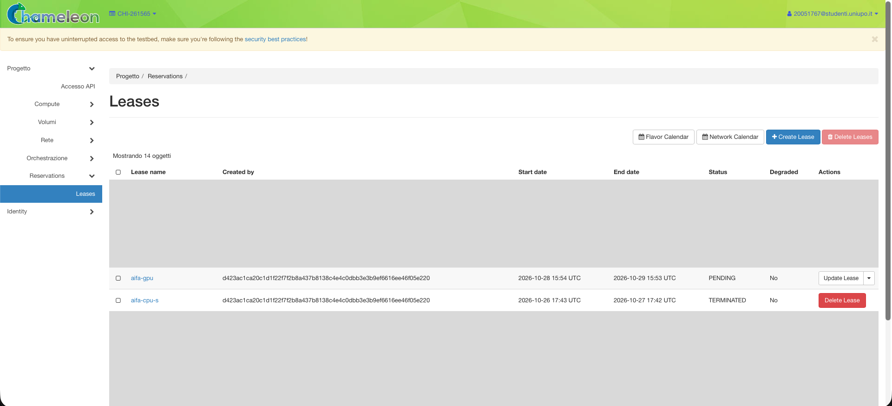
*Il lease della VM `cloud-gpu` in attesa dell'ora di inizio.*


*Il lease diventato `ACTIVE`.*

**4. Istanza.** Con *Avvia istanza* si sceglie nome, immagine `CC-Ubuntu24.04` (`CC-Ubuntu24.04-CUDA` per la GPU), flavor `reservation:<id>`, rete `sharednet1`, coppia di chiavi e security group.

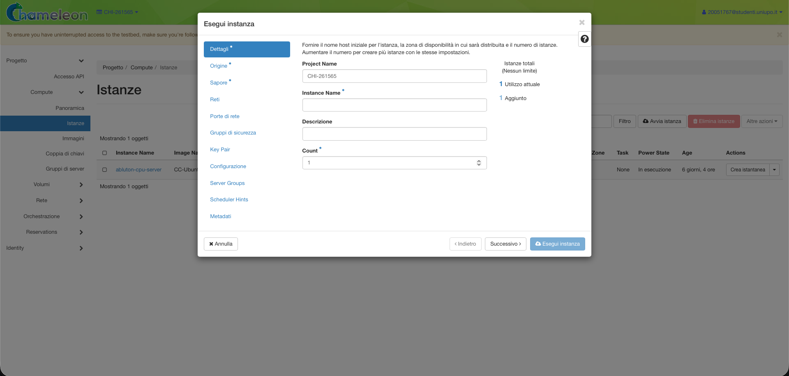
*Avvio dell'istanza, scheda dei dettagli.*

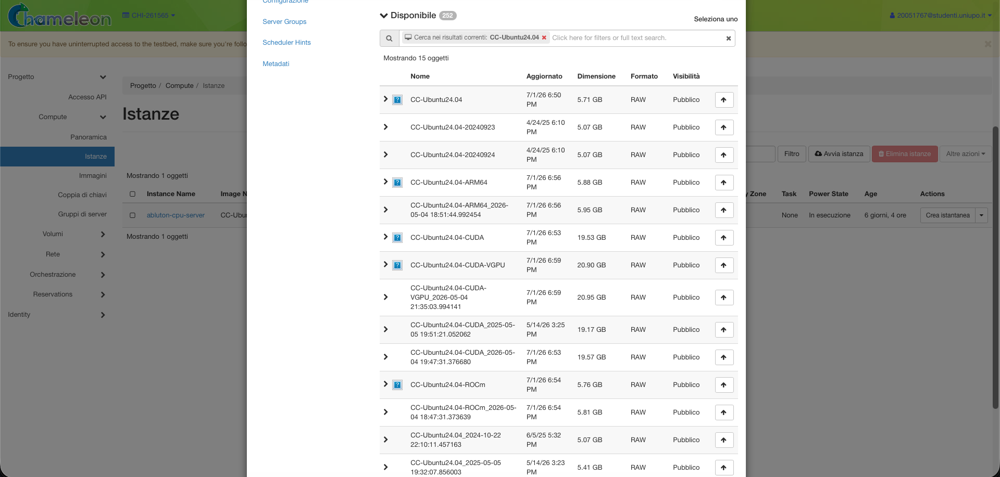
*Avvio dell'istanza, scelta dell'immagine.*

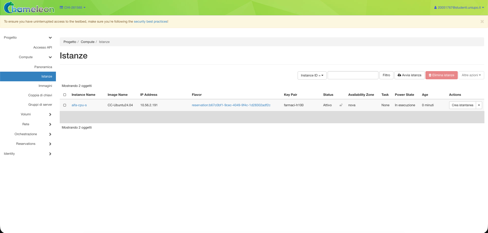
*L'istanza `cloud-cpu-s` attiva.*

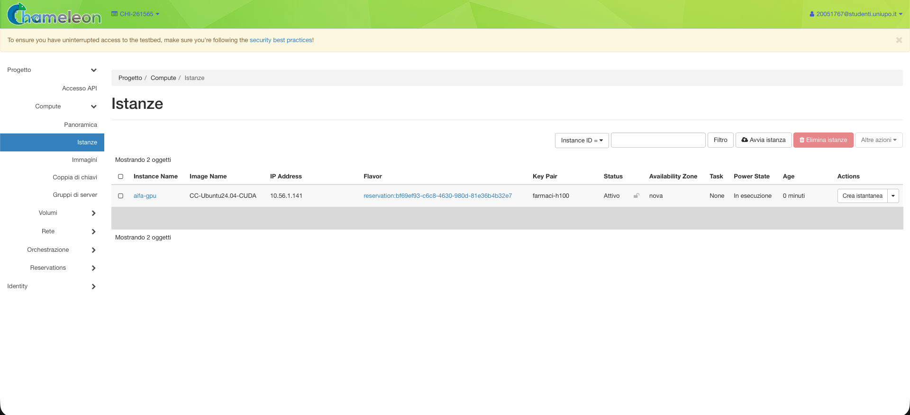
*L'istanza `cloud-gpu` attiva.*

**5. IP pubblico.** Si alloca un floating IP dal pool `public` e lo si associa alla porta della VM.

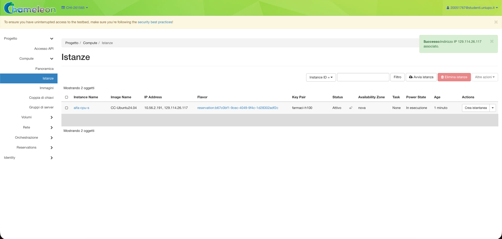
*Il floating IP associato alla VM `cloud-cpu-s`.*

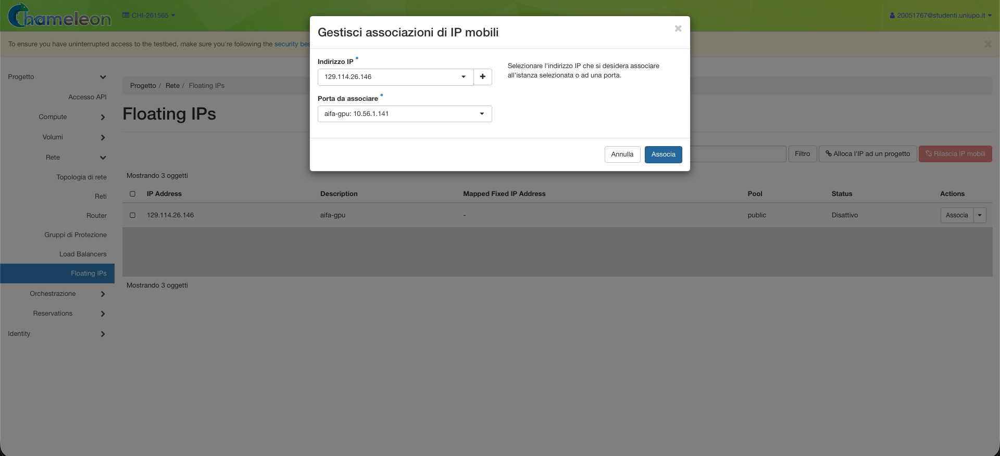
*Il floating IP associato alla VM `cloud-gpu`.*

**6. Accesso SSH.** Ci si collega con la chiave privata e l'utente `cc`.

Tempi rilevati (orari dagli screenshot e dal terminale):

| Passo | `cloud-cpu-s` (26/10) | `cloud-gpu` (28/10) |
|---|---|---|
| creazione lease | 18:42 | ~16:53 |
| lease `ACTIVE` | 18:43 | entro le 16:57 |
| istanza attiva | ~18:47 | 16:57 |
| floating IP associato | 18:48 | 16:58 |
| primo SSH | 18:49:19 | 16:59:28 |
| **tempo fino alla VM raggiungibile** | **~7 min** | **~6,5 min** |

### 5.3 Codice e dati: verso la VM e ritorno

Una VM appena creata contiene solo il sistema operativo. Prima di poter effettuare le misurazioni bisogna portarci il codice, il campione e l'ambiente Python, e alla fine riportare i risultati sul Mac. Di seguito descrivo come ho gestito ciascun passaggio.

#### 5.3.1 Codice

Il repository è privato. Nella procedura manuale a ogni VM è stata associata una *deploy key* GitHub in sola lettura, poi rimossa a fine lavoro, e il codice è stato clonato con `git clone` (2 s). La procedura automatica (§5.4) usa invece un `git bundle`: il commit corrente viene impacchettato in locale (9,8 MB) e inviato via SSH, così sulla VM non serve alcuna credenziale e il codice corrisponde esattamente al commit registrato in `phases.csv`.

#### 5.3.2 Campione

Nella procedura manuale `samples/n500.tar.gz` (294 MB) è copiato con `scp` (26–28 s, ~11 MB/s fino a TACC, in Texas), mentre in quella automatica viene inviato come flusso `tar` via SSH ed estratto direttamente sulla VM.

#### 5.3.3 Ambiente

`chameleon/bootstrap.sh` installa i pacchetti di sistema (compreso Tesseract con la lingua italiana), crea il virtualenv e installa PyTorch nella build CPU o CUDA a seconda che sia presente `nvidia-smi` (~160 s). Il modello bge-m3 viene scaricato prima delle misure (~20 s), così il primo run di s4 non ne include il download.

#### 5.3.4 Esecuzione

I run lunghi girano in `tmux`, che sopravvive alla disconnessione SSH e permette di ricollegarsi per seguire l'avanzamento dei processi.

#### 5.3.5 Ritorno dei risultati

I risultati tornano sul Mac con `rsync` in due passate, prima tutto tranne le cartelle `data/` dei run, poi da queste solo il database SQLite e il collegamento ai PDF, che servono a `collect.py`. Markdown e indici Chroma dei run sul campione sono riproducibili e restano sulla VM. Volumi: 1,4 GB in 113 s (`cloud-cpu-s`, 13 run), 1,9 GB in 162 s (`cloud-gpu`, 17 run).

#### 5.3.6 Full run

Il disco di sistema della VM GPU (40 GB, di cui ~9 GB liberi dopo l'installazione di CUDA e PyTorch) non bastava per il corpus completo. È stato creato un **volume a blocchi** Cinder da 50 GB, collegato alla VM, formattato ext4 e montato in `/mnt/vol` (~2 minuti in tutto).

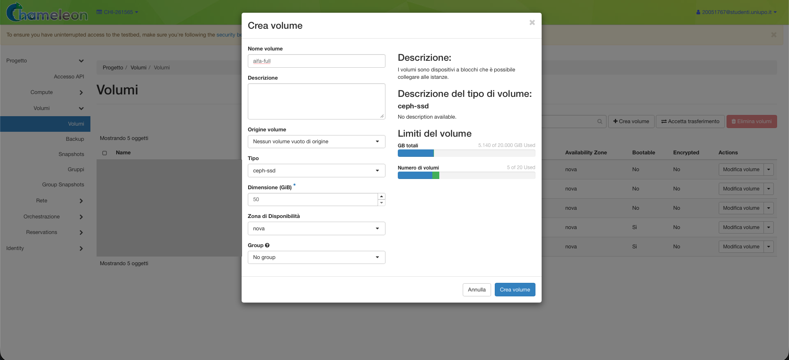
*Creazione del volume da 50 GB per il full run.*

Occupazione finale: PDF 6,1 GB, Markdown 1,1 GB, Chroma 12 GB, SQLite 115 MB, quindi ~19 GB, oltre il disco di sistema disponibile. Sul Mac sono tornati solo tempi, log e database (306 MB).

#### 5.3.7 Pulizia

Floating IP e volume **non** vengono rilasciati alla scadenza o alla cancellazione del lease: dopo il run GPU sono rimasti allocati e sono stati eliminati a mano. Con la procedura automatica questo non succede per il floating IP, che Terraform rilascia con `make down`. Il volume invece non fa parte dell'automazione, perché per le misure sul campione non serve.

### 5.4 Infrastruttura come codice

Una volta create a mano le prime due VM, ho proceduto con l'automatizzazione dell'intero ciclo di vita della macchina, con parametri configurabili come il flavor, il nome del lease e la configurazione da misurare. Il ciclo di vita della VM è descritto da due file versionati, [infra/main.tf](../infra/main.tf) e il [Makefile](../Makefile). I comandi che possono essere lanciati dal Makefile sono:

| Comando | Strumento | Cosa fa |
|---|---|---|
| `make lease` | CLI OpenStack + Blazar [15, 16] | prenota il flavor e attende che il lease sia `ACTIVE` |
| `make up` | Terraform [12] (`infra/main.tf`) | crea security group, porta, istanza e floating IP, poi attende che SSH risponda |
| `make deploy` | `git bundle` + `tar` via SSH | copia codice e campione, esegue `bootstrap.sh`, scarica il modello bge-m3 |
| `make bench` | `tmux` | avvia il piano di misure `bench/plan_<config>.sh` |
| `make fetch` | `rsync` | copia i risultati in `results/<config>/` |
| `make down` | Terraform + CLI OpenStack | distrugge VM, porta, security group, IP e lease |

Scelte di progetto:
- **Lease fuori da Terraform.** Il provider OpenStack di Terraform copre i servizi standard (Nova, Neutron, Cinder) ma non Blazar, che è un'aggiunta di Chameleon. Il lease è quindi creato con la CLI `openstack reservation` e Terraform riceve solo l'id della prenotazione, che su KVM è anche l'id del flavor. L'infrastruttura è in parte **dichiarativa** (Terraform: stato desiderato, `plan`, `apply`, `destroy`) e in parte **imperativa** (comandi CLI); il Makefile le unisce. La libreria python-chi [13] avrebbe fatto lo stesso con più dipendenze.
- **Niente cloud-init.** cloud-init [14] avrebbe solo installato i pacchetti di sistema, che `bootstrap.sh` installa già in ~20 s; senza credenziali non può scaricare il codice. Il Makefile aspetta comunque la fine di cloud-init (`cloud-init status --wait`) prima di usare `apt`.
- **Security group dedicato** con la sola porta 22: quello condiviso nel progetto apre anche le porte 80, 6443 e 11434. Viene creato e distrutto insieme alla VM.
- **Porta esplicita.** La VM si collega alla rete tramite una porta creata da Terraform, a cui si associa il floating IP: allocazione e associazione avvengono in un'unica risorsa, e `destroy` rilascia l'IP.
- **Chiavi host SSH non verificate.** Ogni VM ha una chiave host nuova e gli IP vengono riassegnati, quindi la verifica su `known_hosts` è disattivata. È accettabile per VM usa-e-getta raggiungibili solo con la chiave privata, non per macchine di lunga durata.
- **Controlli.** `make up` si ferma prima di Terraform se il lease non esiste, per non lasciare risorse create a metà; `make deploy` si ferma se il piano di misure non è nel commit, perché il bundle porta solo i commit.
- **Portabilità.** Il Make di macOS (GNU Make 3.81) non supporta `.ONESHELL`, quindi ogni ricetta è un'unica riga logica; `date -v` per la fine del lease è sintassi BSD (su Linux: `date -d`).

### 5.5 Confronto dei tempi

Una volta creata l'automazione, ho proceduto con il confronto dei dati da `results/infra_times.csv` (due cicli completi tra il 29 e il 30/10/2026: un collaudo con distruzione immediata e il run `cloud-cpu-l`):

| Passo | Manuale | IaC, collaudo | IaC, run `cloud-cpu-l` |
|---|---|---|---|
| lease `ACTIVE` | ~1–4 min | 27 s | 27 s |
| VM raggiungibile via SSH | ~6,5–7 min dall'inizio | +42 s (69 s dall'inizio) | +44 s (71 s dall'inizio) |
| configurazione (codice, campione, ambiente, modello) | ~3,7 min di comandi a mano | — | 246 s |
| **pronta per le misure** | **~11 min**, più i passaggi manuali | — | **5 min 17 s** |
| recupero dei risultati (`make fetch`) | `rsync` a mano | — | 7 s |
| distruzione | a mano, IP e volume dimenticati | 19 s, nessun residuo | 21 s, nessun residuo |

Osservazioni:
- Il guadagno è nel provisioning: da ~7 minuti a ~70 secondi, con due misure quasi identiche.
- La configurazione dura quanto a mano (~4 minuti), perché è dominata dall'installazione di pacchetti e PyTorch, non dai tempi umani. È il prossimo punto da ottimizzare, per esempio con un'immagine personalizzata con l'ambiente già installato.
- Rispetto al lavoro utile, l'overhead pagato (`make up` + `make deploy`, 290 s, §6) vale il 2,4% del full run sulla GPU (3,3 h di s3 + s4), ma quasi quanto l'intero run sul campione (6,2 minuti): è l'ingrediente dell'ipotesi H3 (§7.7, §8).

---

## 6. Modello di costo

Chameleon è gratuito per la ricerca e la didattica, quindi il costo in euro è **stimato** con listini commerciali di risorse equivalenti. Tutti i prezzi sono IVA inclusa (22%), dal punto di vista di chi paga davvero.

```
costo_cloud  = Σ_VM (ore_fasi_sulla_VM + ore_overhead) × prezzo_orario_equivalente
costo_locale = ore × (ammortamento_orario + potenza_kW × prezzo_kWh)
```

Il costo si calcola sulla **durata del processo più l'overhead** di provisioning e configurazione (§5.5), non sulla durata del lease: su un cloud commerciale si paga l'istanza accesa e la si spegne a fine lavoro, e con l'automazione lo spegnimento è immediato. La durata del lease conta invece per le SU di Chameleon, che non hanno un prezzo in euro.

L'overhead per VM cloud è il tempo di `make up` + `make deploy` misurato il 29/10/2026: (44 + 246) s = **0,0806 h**, nella colonna `overhead_h` di `bench/prices.csv`. Il lease di Chameleon non ha equivalente nei cloud commerciali e non è contato. Il valore è misurato su una VM CPU e assunto uguale per la VM GPU, dove la configurazione manuale aveva durata simile (§5.3). La configurazione eterogenea usa due VM e paga l'overhead due volte; in locale l'overhead è nullo.

### 6.1 Costo orario della macchina locale

Riassunto dei costi della macchina locale (Mac mini M4):

| Voce | Valore | Fonte |
|---|---|---|
| Prezzo Mac mini M4 (CPU 10 core, GPU 10 core, 16 GB, SSD 512 GB) | 839,00 € IVA inclusa | fattura Apple Store del 04/12/2024 ([copia con dati personali oscurati](fonti/fattura_mac_mini_redatta.pdf)) |
| Vita utile | 4 anni × 365 × 24 = 35.040 h | ipotesi |
| Potenza massima | 65 W (4 W a riposo) | Apple [10], configurazione M4 16 GB |
| Prezzo dell'energia | 0,4343 €/kWh, tasse incluse | ARERA [11], prezzo di riferimento IV trim. 2026 |

```
ammortamento = 839 / 35.040         = 0,0239 €/h
energia      = 0,065 kW × 0,4343    = 0,0282 €/h
totale                              = 0,0522 €/h
```

Ipotesi da dichiarare:
- l'ammortamento su 24 h al giorno è il caso più favorevole al locale. Con un uso effettivo minore il costo orario cresce;
- 65 W è il consumo massimo con CPU e GPU sature: è un limite superiore, il consumo reale durante s3 e s4 è probabilmente più basso;
- 0,4343 €/kWh è la tariffa di riferimento pubblica per i clienti vulnerabili, scelta perché verificabile (la tariffa di mercato libero può differire).

### 6.2 Listini cloud

Prezzi on-demand rilevati il 21 e il 27/10/2026, in [bench/prices.csv](../bench/prices.csv) con fonte e data per ogni riga. I prezzi in dollari sono convertiti al cambio BCE del 21/10/2026 (1 EUR = 1,1234 USD); a tutti è aggiunta l'IVA del 22%.

| Classe | Fornitore | Istanza | €/h IVA incl. | Note |
|---|---|---|---|---|
| 1× H100 | Azure | NC40ads_H100_v5 (40 vCPU, 320 GiB, H100 NVL 94 GB) | 9,7416 | listino in euro, Germany West Central |
| 1× H100 | AWS | p5.4xlarge (16 vCPU, 256 GiB, H100 80 GB) | 7,9946 | Stoccolma; non offerta a Francoforte |
| 1× H100 | Lambda | 1x H100 PCIe (26 vCPU, 225 GiB, 80 GB) | 3,5729 | regione non indicata |
| 1× H100 | RunPod | H100 NVL Secure Cloud (16 vCPU, 94 GB) | 3,4643 | *pod* (container), non VM |
| 16 vCPU | Azure | F16s_v2 (32 GiB) | 0,8331 | Germany West Central |
| 16 vCPU | AWS | c7i.4xlarge (32 GiB) | 0,8849 | Francoforte |
| 16 vCPU | GCP | c4-standard-16 (60 GiB) | 1,0132 | Francoforte |
| 8 vCPU | Azure | F8s_v2 (16 GiB) | 0,4165 | Germany West Central |
| 8 vCPU | AWS | c7i.2xlarge (16 GiB) | 0,4424 | Francoforte |
| 8 vCPU | GCP | c3-standard-8 (32 GiB) | 0,5167 | Francoforte |

Per GCP una VM con una sola H100 (a3-highgpu-1g) non è disponibile on-demand. Il divario tra fornitori per la stessa GPU è di quasi tre volte: la scelta del fornitore pesa più di quella della configurazione (§7.6).

---

## 7. Risultati

In questo capitolo presento i risultati delle misure. Parto dalla conversione dei PDF (s3), prima sul Mac e poi sulle VM cloud, per capire come scala all'aumentare dei worker. Poi passo all'embedding (s4) sui diversi dispositivi, al full run sul corpus completo e al confronto tra campione e corpus. Infine metto insieme tempi e prezzi per calcolare il costo di ogni configurazione e il punto di pareggio tra locale e cloud. Dove non è indicato diversamente, le misure sono fatte sul campione fisso di 972 documenti (§4.2).

Per descrivere lo scaling uso due grandezze. Lo *speedup* dice quante volte un run con *p* worker è più veloce dello stesso run con un solo worker. L'*efficienza* divide lo speedup per il numero di worker e indica quanto viene sfruttato ogni worker aggiunto. Vale 1 se raddoppiando i worker il tempo si dimezza, e scende quando una parte del lavoro non si riesce a dividere tra i worker [6]. In formule, con T(p) il tempo con *p* worker, `S(p) = T(1) / T(p)` e `E(p) = S(p) / p`.

### 7.1 s3: scaling della conversione da PDF a Markdown in locale

`local-cpu-ocr` (con OCR, confrontabile con il cloud), 3 ripetizioni:

| Worker *p* | Tempi (s) | Mediana (s) | Scarto | Doc/s | Speedup S(p) | E(p) |
|---|---|---|---|---|---|---|
| 1 | 1215 · 1208 · 1282 | 1215 | 6,1% | 0,80 | 1,00× | 1,00 |
| 2 | 879 · 886 · 876 | 879 | 1,1% | 1,11 | 1,38× | 0,69 |
| 4 | 1113 · 938 · 1128 | 1113 | 17,1% | 0,87 | 1,09× | 0,27 |
| 8 | 1054 · 1368 · 1058 | 1058 | 29,7% | 0,92 | 1,15× | 0,14 |
| 10 | 1127 · 1144 · 1144 | 1144 | 1,5% | 0,85 | 1,06× | 0,11 |

La serie senza OCR (`local-cpu`) ha lo stesso andamento: 1115 s con 1 worker, minimo di 688 s con 2 (S = 1,62), 1071 s con 10, con scarti sotto il 3,5%. L'OCR costa sul Mac solo il 9–28% in più per documento.

Osservazioni:
- Lo speedup si ferma a 2 worker e oltre **peggiora**: con 10 worker il tempo torna quasi quello seriale.
- La legge di Amdahl [6] non spiega questo andamento: Amdahl non prevede mai un rallentamento all'aumentare dei core, quindi il calo indica contesa su una risorsa condivisa.
- Ipotesi: 
  
  a. contesa tra i processi e i thread interni delle librerie (*oversubscription*);
  
  b. i 6 core efficiency del M4 sono più lenti e diventano il collo di bottiglia;
  
  c. banda di memoria condivisa tra CPU e GPU. La stessa pipeline sulle VM cloud scala quasi linearmente (§7.2), quindi il limite è della macchina, non del codice.
- Gli scarti alti con 4 e 8 worker (17–30%) sono dovuti all'uso del Mac durante quelle serie; la mediana ne attenua l'effetto.

Configurazione locale migliore: 2 worker, 879 s.

### 7.2 s3: scaling sulle VM cloud

Ho ripetuto la stessa misura di s3 sulle tre VM cloud, aumentando ogni volta il numero di worker fino al numero di vCPU disponibili. Le VM sono `cloud-cpu-s` con 8 vCPU Haswell, `cloud-cpu-l` con 16 vCPU Haswell, creata con l'IaC, e la VM `cloud-gpu` con 48 vCPU Sapphire Rapids. Quest'ultima l'ho usata anche per s3, lasciando ferma la GPU, perché è l'unica con più di 16 vCPU e permette di vedere cosa succede oltre quella soglia. Ogni misura è ripetuta 3 volte, tranne quella con un solo worker su `cloud-cpu-l` e sulla VM GPU, che è la più lunga ed è stata eseguita una volta sola.

| VM | *p* | Tempi (s) | Mediana (s) | Scarto | Doc/s | Speedup S(p) | E(p) |
|---|---|---|---|---|---|---|---|
| 8 vCPU | 1 | 4368 · 4369 · 4388 | 4369 | 0,5% | 0,22 | 1,00× | 1,00 |
| 8 vCPU | 2 | 2243 · 2242 · 2254 | 2243 | 0,5% | 0,43 | 1,95× | 0,97 |
| 8 vCPU | 4 | 1154 · 1156 · 1154 | 1154 | 0,2% | 0,84 | 3,79× | 0,95 |
| 8 vCPU | 8 | 595 · 597 · 595 | 595 | 0,3% | 1,63 | 7,34× | 0,92 |
| 16 vCPU | 1 | 4387 | 4387 | — | 0,22 | 1,00× | 1,00 |
| 16 vCPU | 4 | 1156 · 1154 · 1153 | 1154 | 0,3% | 0,84 | 3,80× | 0,95 |
| 16 vCPU | 8 | 598 · 595 · 597 | 597 | 0,5% | 1,63 | 7,35× | 0,92 |
| 16 vCPU | 16 | 319 · 319 · 318 | 319 | 0,3% | 3,05 | 13,75× | 0,86 |
| 48 vCPU | 1 | 2478 | 2478 | — | 0,39 | 1,00× | 1,00 |
| 48 vCPU | 8 | 339 · 338 · 337 | 338 | 0,6% | 2,88 | 7,33× | 0,92 |
| 48 vCPU | 16 | 180 · 181 · 181 | 181 | 0,6% | 5,37 | 13,69× | 0,86 |
| 48 vCPU | 32 | 108 · 111 · 109 | 109 | 2,8% | 8,92 | 22,73× | 0,71 |
| 48 vCPU | 48 | 93 · 90 · 91 | 91 | 3,3% | 10,68 | 27,23× | 0,57 |


Osservazioni:
- Sul cloud lo scarto tra ripetizioni è sotto l'1% fino a 16 worker: le VM sono molto più stabili del Mac in uso.
- **Riproducibilità tra VM.** `cloud-cpu-s` e `cloud-cpu-l` sono VM diverse, una creata a mano e una con Terraform a tre giorni di distanza, con la stessa CPU: con 1, 4 e 8 worker i tempi coincidono entro lo 0,4% (4369 contro 4387 s, 1154 contro 1154, 595 contro 597).
- Lo scaling è quasi lineare fino a 16 worker, con la stessa efficienza (0,86) su `cloud-cpu-l` e sulla VM GPU. Con 32 e 48 l'efficienza cala; il calo è compatibile con Amdahl con una frazione seriale di circa l'1,6% (ricavata da S(48), prevede S(16) ≈ 12,9 e S(32) ≈ 21,3, contro 13,7 e 22,7 misurati). Contribuiscono anche lo sbilanciamento finale (972 documenti su 48 processi, ~20 a testa, con pochi documenti lunghi che allungano la coda) e il fatto che non si sa se le vCPU oltre una certa soglia siano core fisici o hyperthread (§9).
- **Velocità per core** (1 worker, con OCR): M4 1215 s, Sapphire Rapids 2478 s, Haswell 4369 s. Un core Haswell è 3,6 volte più lento di un core M4, ma la VM da 8 vCPU con 8 worker (595 s) batte la configurazione migliore del Mac (879 s), che non riesce a usare i suoi core.

### 7.3 s4: embedding per device

La fase s4 trasforma i frammenti in vettori con il modello bge-m3 e li salva in ChromaDB. È la fase che si avvantaggia di più di una GPU, perché il modello esegue soprattutto moltiplicazioni di matrici. Ho misurato s4 su tutti i dispositivi a disposizione, cioè la CPU e la GPU integrata del Mac, le due VM solo CPU e la H100. Sui dispositivi più lenti una misura dura da 2,4 a quasi 7 ore, quindi l'ho eseguita una volta sola, mentre sulla H100 l'ho ripetuta 3 volte. La velocità è espressa in chunk al secondo, e la colonna "Rispetto alla CPU del Mac" dice quante volte ogni dispositivo è più veloce della CPU del Mac, per cui un valore sotto 1 vuol dire più lento. Il numero di chunk sul Mac è un po' diverso perché lì s4 usa i Markdown convertiti senza OCR (§9).

| Config | Device | Chunk | Batch | Tempo (s) | Chunk/s | Rispetto alla CPU del Mac | Ripetizioni |
|---|---|---|---|---|---|---|---|
| `local-cpu` | CPU M4, 10 core | 31.905 | 64 | 8.536 | 3,74 | 1,00× | 1 |
| `local-mps` | GPU M4 (MPS) | 31.905 | 64 | 24.455 | 1,30 | 0,35× | 1 |
| `cloud-cpu-s` | 8 vCPU Haswell | 31.365 | 64 | 24.666 | 1,27 | 0,34× | 1 |
| `cloud-cpu-l` | 16 vCPU Haswell | 31.365 | 64 | 14.338 | 2,19 | 0,59× | 1 |
| `cloud-gpu` | H100 | 31.365 | 64 | 281 (281 · 282 · 281) | 111,6 | **29,9×** | 3 |
| `cloud-gpu-full` | H100 | 807.495 | 64 | 9.833 | 82,1 | 22,0× | 1 |

Il tempo comprende caricamento del modello, chunking e scrittura in Chroma.

Osservazioni:
- La H100 è ~30 volte più veloce della CPU del Mac e 51–88 volte più veloce delle VM da 16 e 8 vCPU.
- Raddoppiando le vCPU s4 accelera di 1,72 volte (efficienza 0,86, con l'avvertenza della versione di PyTorch diversa, §9), ma anche la VM da 16 vCPU resta 1,7 volte più lenta dei 10 core del Mac: su CPU l'embedding non è un'opzione per il corpus completo.
- Sul Mac la GPU integrata è **2,9 volte più lenta** della CPU con bge-m3 (già emerso nella baseline su un singolo batch); per s4 in locale si usa la CPU.

Sulla H100 ho provato anche diverse dimensioni del *batch*, cioè quanti frammenti il modello elabora insieme in un solo passaggio sulla GPU. Di solito un batch più grande sfrutta meglio la GPU, quindi mi aspettavo i tempi più bassi con 256. Le misure con batch 64 e 256 sono ripetute 3 volte, quelle con 32 e 128 una volta sola.

| Batch | 32 | 64 | 128 | 256 |
|---|---|---|---|---|
| s4 (s) | 262 | 281 | 315 | 410 |
| più veloce del batch 256 (v0) | 1,56× | 1,46× | 1,30× | 1,00× |


Il risultato è l'opposto, cioè il tempo cresce con il batch. `s4_index.py` passa al modello blocchi di 256 testi, il modello li ordina per lunghezza e li divide in sotto-batch della dimensione richiesta, ciascuno completato con *padding* fino al testo più lungo. Sotto-batch piccoli contengono testi di lunghezza simile e quindi meno padding. Sul corpus completo il vantaggio si riduce molto (§7.5): la scelta del batch fatta sul campione va verificata sul carico reale.

### 7.4 Full run sul corpus completo

Le misure precedenti sono tutte sul campione. Per sapere quanto dura davvero l'elaborazione completa, e per controllare se il campione la rappresenta bene, ho eseguito una volta l'intera pipeline sul corpus completo, dal download all'indicizzazione. L'ho fatto il 28/10/2026 sulla VM `cloud-gpu`, con i dati su un volume Cinder (§5.3.6) e batch 64. È la stessa elaborazione della baseline v0, ma questa volta con i tempi di ogni fase registrati e l'uso di CPU e GPU campionato ogni secondo.

| Fase | Durata | Note |
|---|---|---|
| s1 | 3 s | |
| s2 | 9.587 s (2 h 40 min) | 25.198 PDF richiesti a AIFA dal Texas, 6,1 GB |
| s3 | 2.109 s (35 min) | 17.984 documenti con 48 worker (baseline: 37 min) |
| s4 | 9.833 s (2 h 44 min) | 807.495 chunk, 82 chunk/s (baseline: ~2,5 h osservate, batch 256) |
| **totale** | **21.532 s (5 h 59 min)** | di cui s3 + s4: 11.942 s (3 h 19 min) |

Documenti e chunk sono in linea con la baseline (17.959 documenti, 804.995 chunk): +0,1% e +0,3%, probabilmente per documenti pubblicati o aggiornati da AIFA tra luglio e ottobre.

Per capire se la VM era sfruttata bene, durante il run ho registrato ogni secondo quanto lavoravano la CPU e la GPU, con `vmstat` per la CPU e `nvidia-smi` per la GPU. La tabella riporta la media di ogni fase. Una percentuale alta vuol dire che la risorsa stava lavorando, una bassa che era ferma mentre la stavo pagando.

| Fase | CPU (48 vCPU) | GPU (H100) | Memoria della GPU |
|---|---|---|---|
| s3, conversione | occupata al 96% | ferma (0%) | non usata |
| s4, embedding | occupata al 3% | occupata all'83% in media | al massimo 39,6 GB su 94 |

Durante s3 la CPU lavora quasi sempre (del 96%, il 27% è tempo speso dal sistema operativo) e la GPU è ferma. Durante s4 succede il contrario, la GPU lavora e la CPU è quasi inattiva. Anche in s4 la GPU non è sempre al lavoro, perché in circa un secondo su dieci (l'8% dei campioni) è ferma, probabilmente mentre il programma prepara il blocco successivo di testi o scrive i vettori in Chroma.

Nella configurazione monolitica la H100 lavora solo durante s4: download e conversione occupano il **54%** del tempo totale (3 h 15 min su 5 h 59 min) con la GPU ferma, e durante s4 restano inattive le 48 vCPU. È la misura diretta dello spreco che la configurazione eterogenea vuole eliminare (H1).

### 7.5 Campione e corpus completo

Il full run permette di verificare l'estrapolazione lineare dal campione:

| Fase | Previsto dal campione | Misurato | Errore |
|---|---|---|---|
| s3 | 91 s × 17.984 / 972 = 1.684 s | 2.109 s | +25% |
| s4 | 281 s × 807.495 / 31.365 = 7.234 s | 9.833 s | +36% |

La causa non è nella macchina ma nei dati. Per capirlo ho confrontato i chunk dell'indice della baseline v0, che usa la stessa suddivisione in frammenti, separando quelli dei 500 farmaci del campione da quelli del resto del corpus.

| | Chunk | Lunghezza media | Chunk ≥ 1.400 caratteri | Chunk per documento |
|---|---|---|---|---|
| campione n500 (979 documenti) | 31.554 | 1.074 caratteri | 46% | 32,2 |
| resto del corpus (16.976 documenti) | 773.441 | 1.304 caratteri | 62% | 45,6 |

I primi 500 farmaci in ordine di codice sono i più vecchi, e i loro documenti sono più brevi e divisi in frammenti più corti. Un frammento lungo costa di più al modello, perché il calcolo dell'attenzione cresce con la lunghezza del testo. Inoltre il vantaggio del batch piccolo, che riduce il padding (§7.3), si riduce quando molti frammenti sono lunghi e quindi di lunghezza simile tra loro. Lo si vede dai numeri. Sul corpus completo il batch 64 elabora 82 chunk al secondo, un valore vicino ai 77 del batch 256 sul campione e molto lontano dai 112 dello stesso batch 64 sul campione.

Ho anche escluso che il rallentamento dipenda da Chroma, cioè che il database diventi più lento man mano che l'indice cresce. Per tutto il run ogni blocco di 256 chunk ha richiesto circa 3 secondi, dall'inizio alla fine.

Da questo ho tratto una conseguenza per il metodo. Le **proporzioni** tra le configurazioni misurate sul campione restano valide, perché tutte lavorano sugli stessi documenti, ma i **tempi assoluti** ricavati dal campione vanno corretti oppure presi dal full run. Per questo, dove possibile, calcolo il costo del corpus completo dai tempi misurati nel full run.

### 7.6 Tempo e costo

In questa sezione metto insieme i tempi misurati e i prezzi di §6 per stimare quanto costerebbe ogni configurazione su un cloud commerciale. Considero solo s3 e s4, cioè conversione e indicizzazione, perché s1 dura pochi secondi, s2 dipende dalla rete e dai server AIFA più che dalla macchina, e s5 non l'ho misurata sul cloud.

Per ogni configurazione prendo la mediana delle ripetizioni dei run completi s3 + s4 e ci aggiungo l'overhead di creazione e preparazione della VM, ottenendo le ore pagate. Moltiplicando le ore per il prezzo orario di ogni fornitore ottengo il costo, di cui in tabella riporto il fornitore più economico e quello più caro. Il costo per 1.000 documenti serve a confrontare il campione con il corpus completo. Tutti i calcoli sono fatti da `bench/cost_model.py`, che salva i risultati in `results/costs.csv` e `results/costs_split.csv`.

Prima presento le configurazioni che ho effettivamente misurato, poi quella eterogenea, che ho calcolato combinando i tempi delle singole fasi.

#### 7.6.1 Configurazioni misurate

| Configurazione | Ore pagate | Costo | € per 1.000 documenti |
|---|---|---|---|
| `local-cpu`, campione (s3 + s4 su CPU) | 2,67 | 0,14 € | 0,14 |
| `local-mps`, campione (s3 + s4 su MPS) | 7,08 | 0,37 € | 0,38 |
| `cloud-cpu-s`, campione | 7,10 | 2,96 € (Azure) – 3,67 € (GCP) | 3,04 – 3,77 |
| `cloud-cpu-l`, campione | 4,15 | 3,46 € (Azure) – 4,21 € (GCP) | 3,56 – 4,33 |
| `cloud-gpu`, campione, batch 64 | 0,18 | 0,64 € (RunPod) – 1,79 € (Azure) | 0,66 – 1,84 |
| `cloud-gpu-full`, corpus completo | 3,40 | 11,77 € (RunPod) – 33,10 € (Azure) | 0,65 – 1,84 |

Osservazioni:
- La VM con GPU costa **meno** della VM solo CPU, anche se all'ora costa molto di più. Sulla CPU s4 dura ore, e il prezzo orario più basso non basta a compensarle.
- Su tutta la pipeline `cloud-cpu-l` costa il 17% in più di `cloud-cpu-s`. All'ora costa il doppio, ma s4, che occupa quasi tutto il tempo, va solo 1,72 volte più veloce. La VM più grande conviene quindi solo per le fasi che scalano quasi linearmente come s3, ed è proprio quello che sfrutta la configurazione eterogenea (§7.6.2).
- L'overhead fisso pesa molto sui lavori brevi e poco su quelli lunghi. Con la H100 su Azure aumenta del 78% il costo di un run sul campione (1,79 € invece di 1,01 €) e solo del 2,4% quello sul corpus completo (33,10 € invece di 32,32 €).
- Il campione sottostima anche i costi, perché i documenti reali sono più lunghi (§7.5). Senza contare l'overhead, su Azure 1.000 documenti costano 1,04 € sul campione e 1,80 € sul corpus completo.
- In locale il costo in euro è il più basso, ma si paga in tempo. Già il campione richiede ore, e il corpus completo richiederebbe giorni di calcolo continuo (§7.7).

#### 7.6.2 Configurazione eterogenea

La configurazione eterogenea non l'ho eseguita davvero, ma l'ho ricostruita a partire dai tempi delle singole fasi. Immagino due VM usate una dopo l'altra. La prima è una VM solo CPU che esegue s3 con il numero di worker che la rende più veloce, la seconda è la VM con la H100 che esegue s4 con batch 64. Ognuna paga il proprio overhead di creazione e preparazione. Ho considerato solo Azure e AWS, perché tra i fornitori scelti sono gli unici che offrono sia VM solo CPU sia VM con una H100.

Sul corpus completo non ho misurato s3 sulla VM CPU, quindi l'ho stimato partendo dal tempo sul campione e moltiplicandolo per il rapporto tra corpus e campione misurato sulla VM GPU, cioè 2.109 / 91 = 23,2.

| Corpus | Configurazione | Ore | Azure | AWS |
|---|---|---|---|---|
| campione | monolitica (VM GPU) | 0,18 | 1,79 € | 1,47 € |
| campione | split `cloud-cpu-s` (8 worker) + GPU | 0,41 | 1,65 € | 1,38 € |
| campione | split `cloud-cpu-l` (16 worker) + GPU | 0,33 | 1,69 € | 1,42 € |
| completo | monolitica (VM GPU) | 3,40 | 33,10 € | 27,16 € |
| completo | split `cloud-cpu-s` + GPU | 6,72 | 29,02 € | 24,21 € |
| completo | split `cloud-cpu-l` + GPU | 4,95 | 29,17 € | 24,37 € |
| completo, con s2 | monolitica (VM GPU) | 6,06 | 59,05 € | 48,46 € |
| completo, con s2 | split: s2 e s3 su `cloud-cpu-l`, s4 su GPU | 7,61 | 31,39 € | 26,73 € |


Osservazioni:
- Sul corpus completo, contando solo s3 e s4, la configurazione eterogenea (*split* nella tabella) costa il **10–12% in meno** della monolitica, ma impiega il 46% di tempo in più (4,95 h invece di 3,40 h con `cloud-cpu-l`). Le 16 vCPU Haswell impiegano circa 2 ore per convertire quello che le 48 vCPU della VM GPU convertono in 35 minuti. Il risparmio resta piccolo perché la parte più cara è s4, che in entrambi i casi gira sulla GPU.
- Le due VM CPU portano quasi allo stesso costo. `cloud-cpu-l` costa il doppio all'ora, ma grazie allo scaling quasi lineare di s3 (§7.2) dimezza il tempo. A parità di spesa conviene quindi la più grande, che finisce prima.
- Il guadagno vero arriva togliendo il **download dalla GPU**. s2 occupa 2 h 40 min in cui né la GPU né la CPU lavorano (§7.4). Se anche s2 si sposta sulla VM CPU, il costo del corpus completo su Azure scende da 59,05 € a 31,39 € (−47%, e −45% su AWS), con 1,5 h in più. Queste righe le ho calcolate a mano, perché s2 è misurato solo nel full run (`results/cloud-gpu-full/full_s1s2.csv`) e non compare in `all.csv`.
- Sul campione l'overhead pagato due volte riduce il vantaggio al 4–8%, quindi per i lavori brevi separare le fasi conviene poco.
- **Nel grafico** le configurazioni sono ordinate per costo. Sul campione la più economica è il Mac (0,14 €, ma 2,7 h) e la più veloce è la H100 (0,18 h, da 0,64 € con RunPod). Nessun'altra configurazione è più economica *e* più veloce di queste due, che per questo formano la *frontiera di Pareto*. Sul corpus completo invece la H100 di RunPod è sia la più veloce sia la più economica, con 11,77 € contro i 24–29 € della configurazione eterogenea su Azure e AWS. Questo mostra che la scelta del fornitore pesa più dell'architettura. La configurazione eterogenea conviene solo a parità di fornitore, e solo Azure e AWS offrono entrambi i tipi di VM.

### 7.7 Locale o cloud: punto di pareggio

In questa sezione rispondo alla domanda 4 di §1, cioè da quale dimensione del corpus conviene il cloud rispetto al Mac. Per ogni configurazione il tempo e il costo crescono in modo lineare con il numero di documenti *n*. C'è una parte fissa, che esiste solo sul cloud ed è l'overhead di creazione e preparazione della VM, più una parte che cresce con ogni documento, ricavata dai run completi s3 + s4 sul campione.

| | Parte fissa | Tempo per documento | Costo per 1.000 documenti |
|---|---|---|---|
| Mac, CPU | — | 9,89 s | 0,14 € |
| VM H100, batch 64 | 290 s; 0,28 € (RunPod) – 0,79 € (Azure) | 0,38 s | 0,37 € (RunPod) – 1,04 € (Azure) |

- **Tempo.** Il Mac impiega 9,89 secondi per documento, la H100 290 secondi fissi più 0,38 secondi per documento. I due tempi si eguagliano quando 9,89 *n* = 290 + 0,38 *n*, cioè con *n* ≈ 30. Sopra circa 30 documenti la H100 finisce quindi prima del Mac, anche contando l'overhead. Sul campione di 972 documenti impiega 0,18 h invece di 2,7 h.
- **Costo.** In euro il punto di pareggio non esiste. Anche senza contare la parte fissa, ogni documento sulla H100 costa da 2,6 (RunPod) a 7,2 volte (Azure) più che sul Mac, quindi il locale costa meno a ogni dimensione del corpus e non solo sotto una certa soglia. Questo risultato dipende però dall'ammortamento su 24 ore al giorno (§6), che è il caso più favorevole al locale. Se il Mac lavora meno ore, ogni ora deve ripagare una quota più grande del suo prezzo. Il Mac resta più economico della H100 di RunPod finché lavora in media almeno ~5,4 ore al giorno per i 4 anni di ammortamento. Sotto questa soglia l'ammortamento supera 0,106 €/h e la H100 di RunPod diventa più economica.
- **Corpus completo sul Mac (stima).** Non ho eseguito il corpus completo sul Mac, ma posso stimarne la durata scalando i tempi di s3 e s4 del campione con i rapporti tra corpus e campione misurati sulla H100 (23,2 per s3 e 35,0 per s4, §7.5). Il risultato è di circa 90 ore, cioè **~3,7 giorni** di calcolo continuo, per circa 4,70 €. Sulla H100 servono invece 3,4 ore e da 11,77 a 33,10 €. Il cloud quindi non fa risparmiare denaro ma tempo, circa 86 ore in cambio di 7–28 € in più, cioè da 0,08 a 0,33 € per ogni ora risparmiata.

---

## 8. Discussione delle ipotesi

Prima di iniziare le misure, nel piano dell'estensione, avevo formulato quattro ipotesi su come si sarebbero comportate le diverse configurazioni. In questo capitolo le riprendo una per una e le confronto con i risultati del capitolo 7.

**H1. La configurazione eterogenea costa meno della monolitica, impiegando quasi lo stesso tempo.** L'idea era che separando le fasi la GPU venisse pagata solo durante l'embedding. L'ipotesi è **parzialmente confermata**. Lo spreco c'è davvero, perché nel full run la GPU è rimasta ferma per il 54% del tempo (§7.4). Separando s3 e s4 il costo sul corpus completo scende del 10–12%, e se sulla VM CPU si sposta anche il download il risparmio arriva al 45–47% (§7.6). Il tempo però non resta quasi uguale ma cresce del 46%, perché le VM solo CPU disponibili su Chameleon sono molto più lente della VM GPU nella conversione.

**H2. s3 scala quasi linearmente fino a un certo numero di core, poi l'efficienza cala.** Mi aspettavo che oltre una certa soglia aggiungere vCPU servisse sempre meno, per via della lettura da disco e dell'avvio dei processi. Sul cloud l'ipotesi è **confermata**. Fino a 16 worker l'efficienza resta almeno a 0,86, poi scende a 0,71 con 32 e a 0,57 con 48 (§7.2). In locale invece **non è confermata**, perché sul Mac lo scaling si ferma già a 2 worker per un limite della macchina e non del codice (§7.1).

**H3. Sotto una certa dimensione del corpus il locale vince, per l'overhead fisso del cloud.** L'idea era che per pochi documenti il tempo per creare e preparare la VM pesasse più del lavoro vero e proprio. Per il tempo l'ipotesi è **confermata**. Sotto circa 30 documenti il Mac finisce prima, per via dei circa 5 minuti di overhead (§5.5), mentre sopra vince la H100 (§7.7). Per il costo il risultato va oltre l'ipotesi, perché in euro il locale vince a ogni dimensione del corpus. Il motivo però non è l'overhead ma il costo per documento, che sul Mac è da 2,6 a 7,2 volte più basso con l'ammortamento su 24 ore al giorno. L'overhead pesa comunque molto sui lavori brevi, perché aumenta del 78% il costo di un run sul campione con la H100 e solo del 2,4% quello sul corpus completo (§7.6).

**H4. Per l'interrogazione (s5) il cloud non conviene.** In locale una domanda richiede circa 4,5 secondi con la GPU del Mac, e gran parte del tempo va al reranker. Una GPU cloud la renderebbe più veloce, ma andrebbe tenuta sempre accesa per rispondere alle domande. Questa ipotesi **non l'ho misurata**, perché in questa fase s5 è rimasta in locale.

In sintesi:

| Ipotesi | Esito |
|---|---|
| H1, configurazione eterogenea più economica a tempo quasi uguale | parzialmente confermata, costa meno ma impiega di più |
| H2, s3 scala quasi linearmente e poi l'efficienza cala | confermata sul cloud, non in locale |
| H3, sotto una certa dimensione del corpus vince il locale | confermata per il tempo (~30 documenti), in euro il locale vince sempre |
| H4, per s5 il cloud non conviene | non misurata |

---

## 9. Limiti e minacce alla validità

Nessuna misura è perfetta, e alcune scelte che ho fatto per contenere tempi e costi limitano quanto i risultati si possono generalizzare. In questo capitolo elenco i limiti che conosco e, dove possibile, quanto pesano.

- **Processori diversi.** Le VM `m1` usano CPU Intel Haswell, il nodo con la H100 un Xeon Platinum 8468 (Sapphire Rapids) e il Mac un Apple M4. Quando confronto s3 tra macchine diverse mescolo quindi il numero di core con la velocità di ogni core. Per questo in §7.2 riporto anche il tempo con un solo worker su ogni macchina, che misura la velocità del singolo core.
- **Core fisici o virtuali.** La virtualizzazione di Chameleon (KVM) mostra alla VM ogni vCPU come un processore separato, e non dice se dietro c'è un core fisico o un *hyperthread*, cioè metà di un core condiviso con un'altra vCPU. Oltre una certa soglia potrebbero essere hyperthread, e questo abbasserebbe l'efficienza misurata con 32 e 48 worker.
- **Versioni del software.** In locale uso Python 3.13.4 e PyTorch 2.13.0, sul cloud Python 3.12.3 e PyTorch 2.14.1, e su `cloud-cpu-l` PyTorch 2.15.0. `bootstrap.sh` non fissa la versione di PyTorch, e tra il 28 e il 29/10 ne è uscita una nuova. La differenza può influire su s4 su CPU, quindi nei run futuri la versione andrà fissata.
- **OCR.** L'OCR cambia il testo estratto, non solo il tempo. Tra le serie con e senza OCR 142 documenti su 972 hanno un Markdown diverso, e i chunk passano da 31.905 a 31.365. Il Mac con OCR e il cloud producono invece lo stesso testo (33.719.565 contro 33.720.024 caratteri, con 233 pagine passate all'OCR in entrambi i casi). Le misure di s4 in locale usano i chunk senza OCR, ma la differenza è dell'1,7% e non cambia la velocità in modo apprezzabile.
- **Rappresentatività del campione.** Il campione sottostima del 25–36% i tempi del corpus completo, come ho mostrato in §7.5.
- **Misure singole.** Alcune misure le ho eseguite una sola volta perché duravano ore. Sono s4 su CPU e su MPS, il full run, i batch 32 e 128, e s3 con un solo worker sulla VM GPU e su `cloud-cpu-l`.
- **Rete.** La durata di s2 nel full run dipende dal server AIFA e dal collegamento transatlantico fino al Texas, quindi non è una misura della VM.
- **Baseline.** La durata di s4 nella baseline (~2,5 h) l'avevo osservata e non misurata. Il confronto con il full run (2 h 44 min, con batch e software diversi) è quindi solo indicativo.
- **Potenza del Mac.** Per il costo dell'energia uso il consumo massimo dichiarato da Apple, non un consumo misurato.
- **Prezzi.** Uso i listini commerciali come equivalenti perché Chameleon è gratuito, ma le risorse non sono identiche (virtualizzazione, rete, disco, modello di H100). I prezzi inoltre cambiano nel tempo, per questo ognuno ha la sua data e la sua fonte.
- **Configurazione eterogenea calcolata.** Non l'ho eseguita davvero, quindi il calcolo ignora il trasferimento dei Markdown dalla VM CPU alla VM GPU (circa 1 GB sul corpus completo). Inoltre il tempo di s3 della VM CPU sul corpus completo è stimato con il rapporto tra corpus e campione misurato sulla VM GPU.
- **Overhead.** L'ho misurato su una VM CPU di Chameleon e l'ho assunto uguale per la VM GPU. Sui cloud commerciali la creazione di una VM può essere più rapida o più lenta.
- **Log.** PyMuPDF stampa prima di ogni messaggio un blocco crescente di byte nulli, che portava i log fino a 19 MB per run. Il problema riguarda solo la dimensione dei log e non le misure, e ora `run.sh` filtra quei byte.

---

## 10. Conclusioni

Riprendo le cinque domande di §1 e rispondo in base ai risultati.

1. **Quanto costa rendere l'infrastruttura riproducibile?** Poco. Con circa 170 righe tra Makefile e Terraform la VM è raggiungibile in circa 70 secondi invece dei 7 minuti della procedura manuale, ed è pronta per le misure in poco più di 5 minuti. La distruzione libera tutto in circa 20 secondi, senza dimenticare l'IP pubblico. Il tempo che resta è quasi tutto nella configurazione del software (246 s), che un'immagine con l'ambiente già installato ridurrebbe. Sul corpus completo questo overhead vale il 2,4% del costo.
2. **Qual è la configurazione migliore per ciascuna fase?** Il download (s2) dipende dalla rete e va eseguito sulla macchina più economica. La conversione (s3) vuole molti core e scala quasi linearmente fino a 16 worker, tanto che già 8 vCPU Haswell battono il Mac. L'embedding (s4) vuole la GPU, che è da 30 a 88 volte più veloce delle CPU che ho misurato. L'interrogazione (s5) resta in locale.
3. **Una VM unica è uno spreco?** Sì, perché la H100 resta ferma per il 54% del full run. Separare solo s3 fa risparmiare poco (10–12%), perché la parte più cara è s4. Separare anche il download fa risparmiare quasi metà del costo (45–47%), al prezzo di un'ora e mezza in più.
4. **Quando conviene il cloud rispetto alla macchina locale?** In tempo il cloud vince già sopra circa 30 documenti. In euro vince sempre il locale, ma al Mac il corpus completo richiederebbe circa 3,7 giorni. Il cloud quindi vende tempo, a 0,08–0,33 € per ogni ora risparmiata. Per la stessa GPU i fornitori differiscono di quasi 3 volte, e questa scelta pesa più di quella dell'architettura.
5. **Come scala la conversione da PDF a Markdown con il numero di core?** Sul cloud quasi linearmente fino a 16 worker (efficienza 0,86), poi sempre meno (0,57 con 48). Sul Mac si ferma già a 2 worker.

Dal lavoro ho tratto anche una lezione di metodo. Il campione fisso rende i confronti ripetibili ed economici, ma i primi 500 farmaci non rappresentano bene il corpus e sottostimano i tempi reali del 25–36%. Scelte come la dimensione del batch, che sul campione sembravano chiare, vanno quindi verificate sul carico reale.

Il lavoro si può estendere in diverse direzioni:
- creare un'immagine con l'ambiente già installato, per ridurre la configurazione della VM;
- fissare la versione di PyTorch in `bootstrap.sh`;
- eseguire davvero la configurazione eterogenea, misurando anche il trasferimento dei Markdown tra le due VM;
- misurare s5 sul cloud, per verificare l'ipotesi H4.

---

## Appendice A — Riproduzione delle misure locali

```bash
python -m venv .venv && .venv/bin/pip install -r rag/requirements.txt
bench/make_sample.sh 500                                       # campione fisso
for w in 1 2 4 8 10; do for r in 1 2 3; do
  CONFIG=local-cpu-ocr WORKERS=$w bench/run.sh samples/n500 s3 # scaling s3 (Tesseract installato)
done; done
CONFIG=local-cpu DEVICE=cpu bench/run.sh samples/n500          # s3 + s4 su CPU
CONFIG=local-mps DEVICE=mps bench/run.sh samples/n500          # s3 + s4 su MPS
.venv/bin/python bench/collect.py                              # -> results/all.csv
.venv/bin/python bench/cost_model.py                           # -> results/costs*.csv
.venv/bin/python bench/charts.py                               # -> docs/charts/*.png
```

## Appendice B — Riproduzione delle misure cloud

Prerequisiti: credenziali applicative di Chameleon in `~/.config/openstack/clouds.yaml` (cloud
`chameleon`), Terraform, la CLI `openstack` con il plugin Blazar, `jq`, una coppia di chiavi registrata
su Chameleon.

```bash
make lease up deploy bench                     # cloud-cpu-l: piano in bench/plan_cloud-cpu-l.sh
make fetch down                                # a fine misure (log sulla VM: ~/bench.log, BENCH_DONE)
make lease up deploy bench FLAVOR_ID=<id> LEASE_NAME=<nome> CONFIG=<config>   # altre configurazioni
.venv/bin/python bench/collect.py
```

---

## Riferimenti

1. AIFA - Agenzia Italiana del Farmaco, *Liste dei farmaci* (open data).
   https://www.aifa.gov.it/it/liste-dei-farmaci (consultato il 09/07/2026).
2. P. Lewis et al., *Retrieval-Augmented Generation for Knowledge-Intensive NLP Tasks*, NeurIPS 2020.
   arXiv:2005.11401.
3. J. Chen, S. Xiao, P. Zhang, K. Luo, D. Lian, Z. Liu, *BGE M3-Embedding: Multi-Lingual,
   Multi-Functionality, Multi-Granularity Text Embeddings Through Self-Knowledge Distillation*, 2024.
   arXiv:2402.03216.
4. BAAI, *bge-reranker-v2-m3*. https://huggingface.co/BAAI/bge-reranker-v2-m3
5. K. Keahey et al., *Lessons Learned from the Chameleon Testbed*, USENIX Annual Technical Conference
   (ATC '20), 2020.
6. G. M. Amdahl, *Validity of the single processor approach to achieving large scale computing
   capabilities*, AFIPS Spring Joint Computer Conference, 1967.
7. Artifex, *PyMuPDF4LLM*. https://pymupdf.readthedocs.io/en/latest/pymupdf4llm/
8. *Tesseract OCR*. https://github.com/tesseract-ocr/tesseract
9. *Chroma*. https://docs.trychroma.com
10. Apple, *Mac mini power consumption and thermal output (BTU) information*.
    https://support.apple.com/103253 — consultato il 21/10/2026.
11. ARERA, comunicato stampa del 29/09/2026, *Elettricità: maggior tutela +37,3% nel IV trimestre 2026
    per i clienti vulnerabili*.
    https://www.arera.it/comunicati-stampa/dettaglio/elettricita-maggior-tutela-373-nel-iv-trimestre-2026-per-i-clienti-vulnerabili
12. *Terraform OpenStack Provider*.
    https://registry.terraform.io/providers/terraform-provider-openstack/openstack/latest/docs
13. Chameleon Cloud, *python-chi*. https://github.com/ChameleonCloud/python-chi
14. *cloud-init documentation*. https://cloudinit.readthedocs.io
15. OpenStack, *Blazar — Resource Reservation Service*. https://docs.openstack.org/blazar/latest/
16. OpenStack, *OpenStackClient*. https://docs.openstack.org/python-openstackclient/latest/
