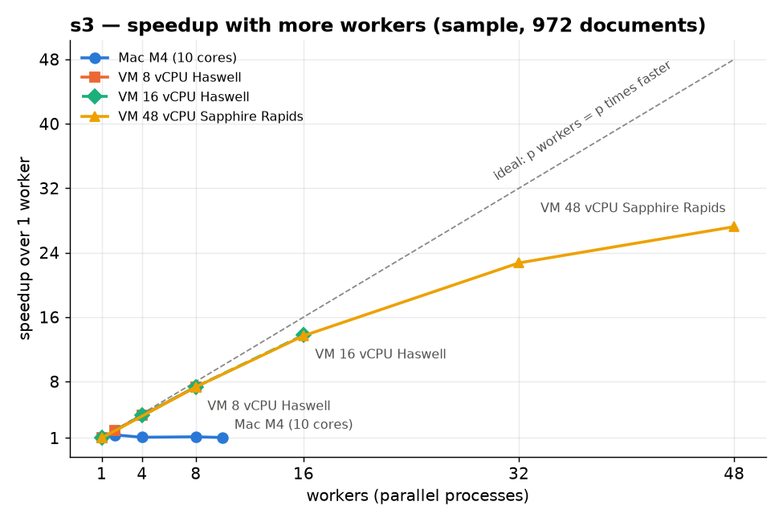
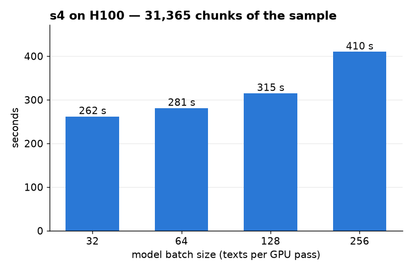
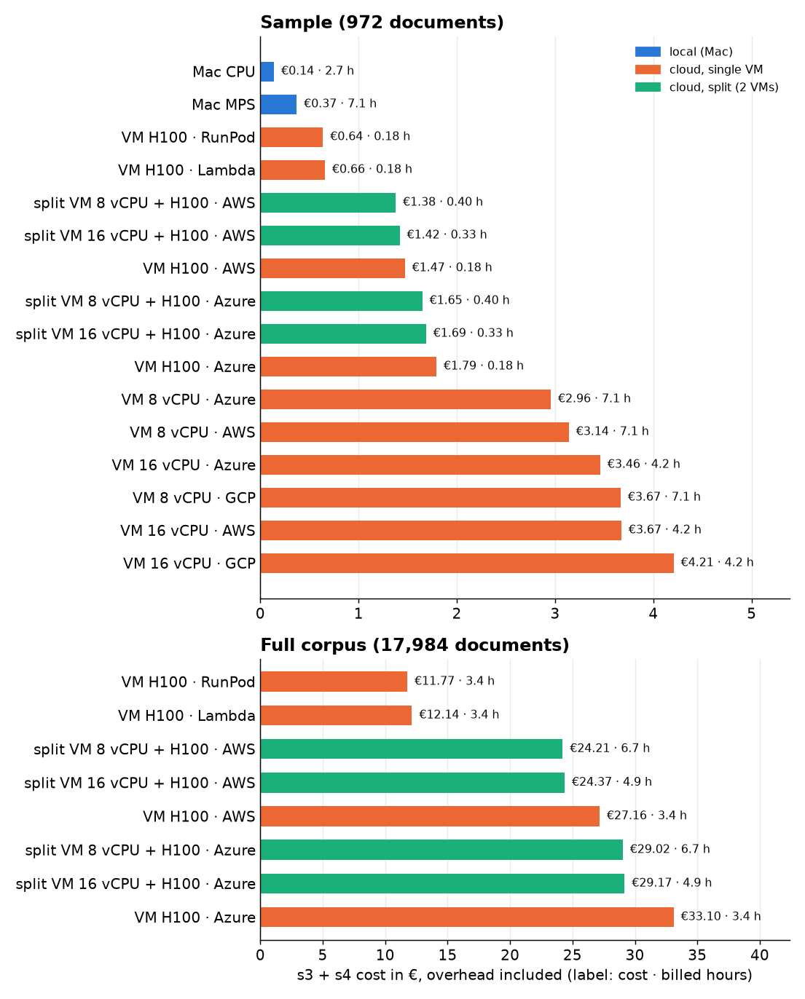

# Infrastructure as Code e confronto costi/prestazioni per una pipeline RAG sui documenti AIFA

**Simone Negro** — matricola 20051767 — Università del Piemonte Orientale
Progetto per il corso del prof. Massimo Canonico — 30/10/2026

---

## Sommario

Il progetto parte da una pipeline RAG (*Retrieval-Augmented Generation*) costruita sui Foglietti
Illustrativi (FI) e sui Riassunti delle Caratteristiche del Prodotto (RCP) pubblicati da AIFA: circa
18.000 documenti PDF convertiti in Markdown, suddivisi in circa 805.000 frammenti e indicizzati in un
database vettoriale. Una prima versione ha eseguito l'elaborazione su una VM di Chameleon Cloud con GPU
H100, configurata a mano. Questa relazione descrive l'estensione concordata: rendere il provisioning
riproducibile come codice (*infrastructure as code*) e confrontare tempi e costi di configurazioni
diverse, locali e cloud, con e senza GPU.

Risultati principali:
- con Terraform e un Makefile il tempo dal comando alla VM raggiungibile scende da ~7 minuti di
  procedura manuale a **~70 secondi**; la VM è pronta per le misure in **~5 minuti**, e la distruzione
  (~20 s) rilascia tutte le risorse, compreso l'IP pubblico che a mano era stato dimenticato (§5);
- la conversione PDF → Markdown (s3) scala quasi linearmente sulle VM cloud (efficienza 0,92 con 8
  worker), mentre sul Mac si ferma a 2 worker (§7.1–7.2);
- l'embedding (s4) sulla H100 è ~30 volte più veloce della CPU del Mac e 51–88 volte più veloce delle
  VM da 16 e 8 vCPU: per il corpus completo servono 2 h 44 min contro giorni (§7.3);
- nella configurazione monolitica la GPU resta inutilizzata per il **54%** del tempo pagato (download e
  conversione), argomento a favore della configurazione eterogenea (§7.4);
- il campione fisso **sottostima** il corpus completo del 25% (s3) e del 36% (s4), perché i suoi
  documenti hanno frammenti più corti (§7.5);
- separare le fasi (s3 su una VM solo CPU, s4 sulla GPU) riduce il costo di s3 + s4 sul corpus
  completo del 10–12%, al prezzo di un tempo maggiore del 46%; spostando anche il download sulla VM
  CPU il risparmio sale al 45–47% (§7.6);
- il fornitore pesa più dell'architettura: s3 + s4 sul corpus completo costano da 11,77 € (H100 su
  RunPod) a 33,10 € (H100 su Azure) (§7.6);
- l'overhead fisso di ~5 minuti vale il 78% del costo di un run sul campione con la H100 e il 2,4%
  sul corpus completo; in tempo il cloud batte il Mac già sopra ~30 documenti, in euro il Mac resta
  più economico a ogni dimensione, ma il corpus completo gli richiederebbe ~3,7 giorni (§7.7).

---

## 1. Introduzione e obiettivi

Nella prima versione del progetto il cloud era usato come semplice potenza di calcolo a noleggio:
una VM prenotata dalla dashboard, configurata via SSH con uno script, rilasciata a mano. Su indicazione
del docente (scambio email del 28/09–14/10/2026), tra le tre estensioni proposte è stata scelta la terza:

> automatizzare il provisioning dell'infrastruttura (infrastructure as code) e confrontare costi e
> prestazioni di diverse configurazioni (solo CPU, GPU, locale e cloud).

Domande di ricerca:

1. **Quanto costa rendere l'infrastruttura riproducibile?** Tempo dal comando di provisioning alla VM
   pronta, rispetto alla durata del lavoro utile.
2. **Qual è la configurazione migliore per ciascuna fase?** Le fasi della pipeline hanno profili di
   carico diversi (rete, CPU, GPU).
3. **Una VM unica è uno spreco?** Confronto tra configurazione monolitica (una VM GPU per tutto) ed
   eterogenea (VM CPU per la conversione, VM GPU solo per l'embedding).
4. **Quando conviene il cloud rispetto al locale?** Punto di pareggio in funzione della dimensione del
   corpus.
5. **Come scala la conversione PDF → Markdown con il numero di core?**

---

## 2. Contesto: dati e pipeline

### 2.1 Dati

Tre file CSV dalla sezione *Liste dei farmaci* degli open data AIFA [1], scaricati il 09/07/2026:

| File | Righe | Contenuto |
|---|---|---|
| `atc.csv` | 7.209 | Classificazione ATC → descrizione |
| `PA_confezioni.csv` | 337.550 | Principi attivi per confezione (codice AIC) |
| `confezioni_fornitura.csv` | 159.708 | Anagrafica confezioni, con i link ai PDF di FI e RCP |

Le 159.708 confezioni corrispondono a 12.599 farmaci distinti (`COD_FARMACO`) e i PDF sono per farmaco:
deduplicando, i documenti da scaricare passano da circa 320.000 link a 25.198 (un FI e un RCP per
farmaco). Di questi, circa 18.000 sono disponibili (17.959 nella baseline, 17.984 nel full run del
28/10/2026); gli altri rispondono 404 (non pubblicati) o 500.

### 2.2 Pipeline

RAG ibrido [2]: le domande sui dati tabellari si risolvono in SQL (SQLite), il testo libero dei
documenti è indicizzato in un database vettoriale (ChromaDB [9]). Le fasi:

| Fase | Script | Cosa fa | Risorsa limitante |
|---|---|---|---|
| s1 | `s1_structured.py` | CSV → SQLite con indici | disco (secondi) |
| s2 | `s2_download.py` | download asincrono dei PDF, manifest in SQLite | rete, cortesia verso AIFA |
| s3 | `s3_pdf_to_md.py` | PDF → Markdown con PyMuPDF4LLM [7] e OCR Tesseract [8], in parallelo | CPU |
| s4 | `s4_index.py` | chunking per sezione, embedding con bge-m3 [3], indicizzazione | GPU |
| s5 | `s5_query.py` | retrieval (30 candidati) → reranking con bge-reranker-v2-m3 [4] (6 tenuti) → LLM | latenza |

Il dettaglio di ogni fase è in [LAVORO_SVOLTO.md](../LAVORO_SVOLTO.md).

---

## 3. Baseline v0: run manuale su Chameleon Cloud

Chameleon [5] è un testbed per la ricerca sui sistemi cloud basato su OpenStack; le risorse si
ottengono tramite *lease* (prenotazioni a tempo). La baseline è stata eseguita sul sito KVM@TACC:

- VM con 1 GPU NVIDIA H100 (94 GB), 48 vCPU, 250 GB di RAM, Ubuntu 22.04;
- lease e istanza creati dalla dashboard, configurazione con `chameleon/bootstrap.sh` via SSH;
- run completo con `chameleon/run_full.sh`, risultati riportati in locale con `rsync`.

Risultati (commit `93b93de`, tag `baseline-v0`):

| Fase | Cloud (H100 + 48 vCPU) | Note |
|---|---|---|
| s3, 17.959 documenti | 37 min | 48 processi paralleli, OCR attivo |
| s4, 804.995 chunk | ~2,5 h | batch 256; durata osservata, non misurata in modo controllato |
| s5, latenza per domanda | — | eseguita in locale: ~4,5 s con MPS, ~17,7 s su sola CPU |

Limiti di questa versione, che motivano l'estensione:
- provisioning manuale e non versionato;
- una sola configurazione misurata, quindi nessun confronto;
- nessuna stima dei costi;
- risorse inutilizzate: la H100 resta ferma durante s3, i 48 vCPU quasi inattivi durante s4;
- tempi in parte stimati o ricavati da un singolo batch.

---

## 4. Metodologia

### 4.1 Configurazioni

| ID | Dove | Risorse | Stato |
|---|---|---|---|
| `local-cpu` | Mac mini M4 (2024) | CPU 10 core (4 performance + 6 efficiency), 16 GB; s3 senza OCR | ✅ |
| `local-cpu-ocr` | Mac mini M4 (2024) | come sopra, s3 con OCR (Tesseract installato) | ✅ |
| `local-mps` | Mac mini M4 (2024) | GPU integrata 10 core via Metal (MPS) | ✅ |
| `cloud-cpu-s` | Chameleon KVM@TACC, flavor `m1.xlarge` | 8 vCPU Intel Haswell, 16 GB | ✅ |
| `cloud-cpu-l` | Chameleon KVM@TACC, flavor `m1.xxlarge` | 16 vCPU Intel Haswell, 32 GB; creata con l'IaC | ✅ |
| `cloud-gpu` | Chameleon KVM@TACC, flavor `g1.h100.pci.1` | 1× H100 94 GB, 48 vCPU Xeon Platinum 8468, 240 GB | ✅ |
| `cloud-gpu-full` | come `cloud-gpu` | corpus completo, una esecuzione | ✅ |
| `cloud-split` | `cloud-cpu-l` per s3 + `cloud-gpu` per s4 | calcolata dai tempi per fase, non eseguita | ✅ (§7.6) |

Rispetto al piano iniziale `cloud-cpu-l` ha 16 vCPU invece di 48: su KVM@TACC il flavor solo CPU più
grande è `m1.xxlarge` (§5.1). Lo scaling di s3 fino a 48 processi è stato misurato sulla VM GPU, che
ha 48 vCPU ma un processore diverso (§7.2, §9).

### 4.2 Campione fisso

Ripetere più volte il corpus completo su ogni configurazione non è sostenibile (circa 60 h di sola
indicizzazione sulla CPU locale, vedi §7.3), e ogni run ricontatterebbe AIFA per 25.000 download.
Si usa quindi un **campione fisso**, creato una volta con `bench/make_sample.sh 500`:

- i primi 500 farmaci in ordine di `COD_FARMACO` (ordinamento esplicito, quindi campione stabile);
- 1.000 PDF richiesti, **972 validi**, che producono **31.905 chunk** senza OCR e **31.365** con OCR
  (§9);
- archiviato come `samples/n500.tar.gz` (SQLite con il manifest + PDF, 294 MB) e copiato su ogni VM
  (§5.3).

L'ipotesi di partenza era estrapolare linearmente: s3 in base al numero di documenti, s4 in base al
numero di chunk. Il full run del 28/10 ha permesso di verificarla: l'estrapolazione **sottostima** i
tempi reali del 25–36% (§7.5).

### 4.3 Strumentazione

Ogni misura è un run di `bench/run.sh`, che:
1. crea una cartella `results/<config>/<run_id>/` con una copia del database del campione e un
   collegamento in sola lettura ai PDF, così ogni run parte dallo stesso stato e non tocca i dati
   della baseline;
2. esegue le fasi richieste registrando inizio, fine e durata in `phases.csv`, insieme a commit,
   host, numero di CPU, worker, device e dimensione del batch;
3. su Linux registra in background l'utilizzo di CPU (`vmstat`, ogni secondo) e GPU (`nvidia-smi`,
   ogni secondo).

`bench/collect.py` unisce tutti i run in `results/all.csv`, aggiungendo campione, documenti
convertiti e chunk indicizzati letti dalla cartella di ogni run. I tempi di infrastruttura (lease,
creazione, configurazione, distruzione) sono scritti dal Makefile in `results/infra_times.csv` (§5.4).

### 4.4 Protocollo

- 3 ripetizioni per misura, si riporta la mediana e lo scarto (massimo − minimo) in percentuale della
  mediana; le eccezioni (misure singole) sono indicate;
- commit registrato in ogni riga di `phases.csv`;
- versioni bloccate in `rag/requirements.txt`; l'interprete e PyTorch dipendono dalla macchina:
  Python 3.13.4 e PyTorch 2.13.0 in locale, Python 3.12.3 e PyTorch 2.14.1 su `cloud-cpu-s` e
  `cloud-gpu` (build CPU e CUDA 12.6), PyTorch 2.15.0 su `cloud-cpu-l` (§9);
- macchina locale con la sospensione di sistema disattivata (`caffeinate -i`);
- s4 su CPU e su MPS misurata con una sola ripetizione per la durata (da 2,4 h a 6,9 h); per run così
  lunghi la variabilità relativa attesa è bassa, e sulle VM cloud lo scarto tra ripetizioni è rimasto
  sotto l'1% per s4 (§7.3).

---

## 5. Provisioning: dalla procedura manuale all'infrastruttura come codice

### 5.1 Risorse su Chameleon KVM@TACC

Le misure cloud usano il progetto Chameleon *BioG-LLM* (CHI-261565), con un'allocazione di 20.000
*Service Unit* (SU) valida fino al 26/01/2027 ([screenshot](img/chameleon/01-allocazione-biog-llm.png)).
Su KVM@TACC ogni istanza richiede un lease di Blazar [15] che prenota un *flavor*: quando il lease
diventa `ACTIVE` compare un flavor dedicato chiamato `reservation:<id>`, il cui id coincide con quello
della prenotazione. Le SU si consumano per tutta la durata del lease, non solo mentre la VM lavora:
conviene quindi cancellarlo appena finite le misure.

Flavor disponibili rilevanti:

| Flavor | vCPU | RAM | Acceleratore | Uso |
|---|---|---|---|---|
| `m1.xlarge` | 8 | 16 GB | — | `cloud-cpu-s` |
| `m1.xxlarge` | 16 | 32 GB | — | `cloud-cpu-l` (il più grande solo CPU) |
| `g1.h100.pci.1` | 48 | 250 GB | 1× H100 | `cloud-gpu` |
| `g1.h100.vgpu.1g.12gb` | 6 | 36 GB | 1/7 di H100 (12 GB) | non usato |

### 5.2 Procedura manuale

Le VM `cloud-cpu-s` (26/10/2026) e `cloud-gpu` (28/10/2026) sono state create dalla dashboard
(OpenStack Horizon), documentando ogni passo:

1. **Progetto e allocazione**: selezione del progetto con allocazione attiva
   ([00](img/chameleon/00-progetti.png), [01](img/chameleon/01-allocazione-biog-llm.png); il progetto
   del corso, [senza allocazione](img/chameleon/01a-ccc2425-senza-allocazione.png), non permette di
   creare risorse).
2. **Accesso**: coppia di chiavi SSH ([03](img/chameleon/03-keypair.png)) e security group con la
   porta 22 aperta ([04](img/chameleon/04-security-group.png)).
3. **Lease**: per la H100 si controlla prima la disponibilità nel calendario dei flavor
   ([14](img/chameleon/14-flavor-calendar-h100.png)); poi *Create Lease* con il flavor
   ([05](img/chameleon/05-lease-flavor.png)), senza prenotare reti
   ([05b](img/chameleon/05b-lease-reti.png)); il lease passa da `PENDING`
   ([06a](img/chameleon/06a-lease-pending.png), [15](img/chameleon/15-lease-gpu-pending.png)) ad
   `ACTIVE` ([06](img/chameleon/06-lease-active.png)).
4. **Istanza**: *Avvia istanza* con nome, immagine `CC-Ubuntu24.04` (`CC-Ubuntu24.04-CUDA` per la
   GPU), flavor `reservation:<id>`, rete `sharednet1`, coppia di chiavi e security group
   ([07a](img/chameleon/07a-istanza-dettagli.png), [07](img/chameleon/07-istanza-origine.png),
   [09](img/chameleon/09-istanza-attiva.png), [16](img/chameleon/16-istanza-gpu-attiva.png)).
5. **IP pubblico**: allocazione di un floating IP dal pool `public` e associazione alla porta della
   VM ([10](img/chameleon/10-floating-ip.png), [17](img/chameleon/17-floating-ip-gpu.png)).
6. **Accesso SSH** con la chiave privata e l'utente `cc`.

Negli screenshot le risorse di altri membri del progetto sono coperte in grigio.

Tempi rilevati (orari dagli screenshot e dal terminale):

| Passo | `cloud-cpu-s` (26/10) | `cloud-gpu` (28/10) |
|---|---|---|
| creazione lease | 18:42 | ~16:53 |
| lease `ACTIVE` | 18:43 | entro le 16:57 |
| istanza attiva | ~18:47 | 16:57 |
| floating IP associato | 18:48 | 16:58 |
| primo SSH | 18:49:19 | 16:59:28 |
| **tempo fino alla VM raggiungibile** | **~7 min** | **~6,5 min** |

### 5.3 Codice e dati: verso la VM e ritorno

**Codice.** Il repository è privato. Nella procedura manuale a ogni VM è stata associata una *deploy
key* GitHub in sola lettura, poi rimossa a fine lavoro, e il codice è stato clonato con `git clone`
(2 s). La procedura automatica (§5.4) usa invece un `git bundle`: il commit corrente viene impacchettato
in locale (9,8 MB) e inviato via SSH, così sulla VM non serve alcuna credenziale e il codice
corrisponde esattamente al commit registrato in `phases.csv`.

**Campione.** `samples/n500.tar.gz` (294 MB) è copiato con `scp` (26–28 s, ~11 MB/s fino a TACC,
in Texas) oppure inviato come flusso `tar` via SSH.

**Ambiente.** `chameleon/bootstrap.sh` installa i pacchetti di sistema (compreso Tesseract con la
lingua italiana), crea il virtualenv e installa PyTorch nella build CPU o CUDA a seconda che sia
presente `nvidia-smi` (~160 s). Il modello bge-m3 viene scaricato prima delle misure (~20 s), così il
primo run di s4 non ne include il download.

**Esecuzione.** I run lunghi girano in `tmux`, che sopravvive alla disconnessione SSH.

**Ritorno dei risultati.** `rsync` in due passate: prima tutto tranne le cartelle `data/` dei run,
poi da queste solo il database SQLite e il collegamento ai PDF, che servono a `collect.py`. Markdown e
indici Chroma dei run sul campione sono riproducibili e restano sulla VM. Volumi: 1,4 GB in 113 s
(`cloud-cpu-s`, 13 run), 1,9 GB in 162 s (`cloud-gpu`, 17 run).

**Full run.** Il disco di sistema della VM GPU (40 GB, di cui ~9 GB liberi dopo l'installazione di
CUDA e PyTorch) non bastava per il corpus completo. È stato creato un **volume a blocchi** Cinder da
50 GB ([18](img/chameleon/18-volume-crea.png)), collegato alla VM, formattato ext4 e montato in
`/mnt/vol` (~2 minuti in tutto). Occupazione finale: PDF 6,1 GB, Markdown 1,1 GB, Chroma 12 GB,
SQLite 115 MB, quindi ~19 GB, oltre il disco di sistema disponibile. Sul Mac sono tornati solo tempi,
log e database (306 MB).

**Pulizia.** Floating IP e volume **non** vengono rilasciati alla scadenza o alla cancellazione del
lease: dopo il run GPU sono rimasti allocati e sono stati eliminati a mano. È uno degli errori che la
procedura automatica elimina.

### 5.4 Infrastruttura come codice

L'intero ciclo di vita della VM è descritto da due file versionati, [infra/main.tf](../infra/main.tf)
e il [Makefile](../Makefile):

```
make lease    CLI OpenStack + Blazar [15,16]   prenota il flavor, attende ACTIVE
make up       Terraform [12] (infra/main.tf)   security group, porta, istanza, floating IP; attende SSH
make deploy   git bundle + tar via SSH         codice, campione, bootstrap.sh, modello bge-m3
make bench    tmux                             piano di misure bench/plan_<config>.sh
make fetch    rsync                            risultati in results/<config>/
make down     terraform destroy + lease delete VM, porta, security group, IP e lease
```

Scelte di progetto:
- **Lease fuori da Terraform.** Il provider OpenStack di Terraform copre i servizi standard (Nova,
  Neutron, Cinder) ma non Blazar, che è un'aggiunta di Chameleon. Il lease è quindi creato con la CLI
  `openstack reservation` e Terraform riceve solo l'id della prenotazione, che su KVM è anche l'id del
  flavor. L'infrastruttura è in parte **dichiarativa** (Terraform: stato desiderato, `plan`, `apply`,
  `destroy`) e in parte **imperativa** (comandi CLI); il Makefile le unisce. La libreria python-chi
  [13] avrebbe fatto lo stesso con più dipendenze.
- **Niente cloud-init.** cloud-init [14] avrebbe solo installato i pacchetti di sistema, che
  `bootstrap.sh` installa già in ~20 s; senza credenziali non può scaricare il codice. Il Makefile
  aspetta comunque la fine di cloud-init (`cloud-init status --wait`) prima di usare `apt`.
- **Security group dedicato** con la sola porta 22: quello condiviso nel progetto apre anche le porte
  80, 6443 e 11434. Viene creato e distrutto insieme alla VM.
- **Porta esplicita.** La VM si collega alla rete tramite una porta creata da Terraform, a cui si
  associa il floating IP: allocazione e associazione avvengono in un'unica risorsa, e `destroy` rilascia
  l'IP.
- **Chiavi host SSH non verificate.** Ogni VM ha una chiave host nuova e gli IP vengono riassegnati,
  quindi la verifica su `known_hosts` è disattivata. È accettabile per VM usa-e-getta raggiungibili
  solo con la chiave privata, non per macchine di lunga durata.
- **Controlli.** `make up` si ferma prima di Terraform se il lease non esiste, per non lasciare
  risorse create a metà; `make deploy` si ferma se il piano di misure non è nel commit, perché il bundle
  porta solo i commit.
- **Portabilità.** Il Make di macOS (GNU Make 3.81) non supporta `.ONESHELL`, quindi ogni ricetta è
  un'unica riga logica; `date -v` per la fine del lease è sintassi BSD (su Linux: `date -d`).

### 5.5 Confronto dei tempi

Dati da `results/infra_times.csv` (due cicli completi il 29/10/2026: un collaudo con distruzione
immediata e il run `cloud-cpu-l`):

| Passo | Manuale | IaC, collaudo | IaC, run `cloud-cpu-l` |
|---|---|---|---|
| lease `ACTIVE` | ~1–4 min | 27 s | 27 s |
| VM raggiungibile via SSH | ~6,5–7 min dall'inizio | +42 s (69 s dall'inizio) | +44 s (71 s dall'inizio) |
| configurazione (codice, campione, ambiente, modello) | ~3,7 min di comandi a mano | — | 246 s |
| **pronta per le misure** | **~11 min**, più i passaggi manuali | — | **5 min 17 s** |
| recupero dei risultati (`make fetch`) | `rsync` a mano | — | 7 s |
| distruzione | a mano, IP e volume dimenticati | 19 s, nessun residuo | 21 s, nessun residuo |

Osservazioni:
- Il guadagno è nel provisioning: da ~7 minuti a ~70 secondi, con due misure quasi identiche.
- La configurazione dura quanto a mano (~4 minuti), perché è dominata dall'installazione di pacchetti
  e PyTorch, non dai tempi umani. È il prossimo punto da ottimizzare, per esempio con un'immagine
  personalizzata con l'ambiente già installato.
- Rispetto al lavoro utile, ~5 minuti di overhead pesano il 2,6% del full run sulla GPU (3,3 h di s3 +
  s4), ma quanto l'intero run sul campione (6,2 minuti): è l'ingrediente dell'ipotesi H3 (§8).

---

## 6. Modello di costo

Chameleon è gratuito per la ricerca e la didattica, quindi il costo in euro è **stimato** con listini
commerciali di risorse equivalenti. Tutti i prezzi sono IVA inclusa (22%), dal punto di vista di chi
paga davvero.

```
costo_cloud  = Σ_fasi (ore_fase + ore_overhead) × prezzo_orario_equivalente
costo_locale = ore × (ammortamento_orario + potenza_kW × prezzo_kWh)
```

Il costo si calcola sulla **durata del processo più l'overhead** di provisioning e configurazione
(§5.5), non sulla durata del lease: su un cloud commerciale si paga l'istanza accesa e la si spegne a
fine lavoro, e con l'automazione lo spegnimento è immediato. La durata del lease conta invece per le SU
di Chameleon, che non hanno un prezzo in euro.

L'overhead per VM cloud è il tempo di `make up` + `make deploy` misurato il 29/10/2026: (44 + 246) s
= **0,0806 h**, nella colonna `overhead_h` di `bench/prices.csv`. Il lease di Chameleon non ha
equivalente nei cloud commerciali e non è contato. Il valore è misurato su una VM CPU e assunto uguale
per la VM GPU, dove la configurazione manuale aveva durata simile (§5.3). La configurazione eterogenea
usa due VM e paga l'overhead due volte; in locale l'overhead è nullo.

### 6.1 Costo orario della macchina locale

| Voce | Valore | Fonte |
|---|---|---|
| Prezzo Mac mini M4 (CPU 10 core, GPU 10 core, 16 GB, SSD 512 GB) | 839,00 € IVA inclusa | fattura Apple Store del 04/12/2024 ([copia con dati personali oscurati](fonti/fattura_mac_mini_redatta.pdf)) |
| Vita utile | 4 anni × 365 × 24 = 35.040 h | ipotesi |
| Potenza massima | 65 W (4 W a riposo) | Apple [10], configurazione M4 16 GB |
| Prezzo dell'energia | 0,4343 €/kWh, tasse incluse | ARERA [11], prezzo di riferimento IV trim. 2026 |

```
ammortamento = 839 / 35.040         = 0,0239 €/h
energia      = 0,065 kW × 0,4343    = 0,0282 €/h
totale                              = 0,0522 €/h
```

Ipotesi conservative da dichiarare:
- l'ammortamento su 24 h al giorno è il caso più favorevole al locale; con un uso effettivo minore il
  costo orario cresce;
- 65 W è il consumo massimo con CPU e GPU sature: è un limite superiore, il consumo reale durante s3 e
  s4 è probabilmente più basso;
- 0,4343 €/kWh è la tariffa di riferimento pubblica per i clienti vulnerabili, scelta perché
  verificabile; la tariffa di mercato libero può differire.

### 6.2 Listini cloud

Prezzi on-demand rilevati il 21 e il 27/10/2026, in [bench/prices.csv](../bench/prices.csv) con fonte
e data per ogni riga. I prezzi in dollari sono convertiti al cambio BCE del 21/10/2026
(1 EUR = 1,1234 USD); a tutti è aggiunta l'IVA del 22%.

| Classe | Fornitore | Istanza | €/h IVA incl. | Note |
|---|---|---|---|---|
| 1× H100 | Azure | NC40ads_H100_v5 (40 vCPU, 320 GiB, H100 NVL 94 GB) | 9,7416 | listino in euro, Germany West Central |
| 1× H100 | AWS | p5.4xlarge (16 vCPU, 256 GiB, H100 80 GB) | 7,9946 | Stoccolma; non offerta a Francoforte |
| 1× H100 | Lambda | 1x H100 PCIe (26 vCPU, 225 GiB, 80 GB) | 3,5729 | regione non indicata |
| 1× H100 | RunPod | H100 NVL Secure Cloud (16 vCPU, 94 GB) | 3,4643 | *pod* (container), non VM |
| 16 vCPU | Azure | F16s_v2 (32 GiB) | 0,8331 | Germany West Central |
| 16 vCPU | AWS | c7i.4xlarge (32 GiB) | 0,8849 | Francoforte |
| 16 vCPU | GCP | c4-standard-16 (60 GiB) | 1,0132 | Francoforte |
| 8 vCPU | Azure | F8s_v2 (16 GiB) | 0,4165 | Germany West Central |
| 8 vCPU | AWS | c7i.2xlarge (16 GiB) | 0,4424 | Francoforte |
| 8 vCPU | GCP | c3-standard-8 (32 GiB) | 0,5167 | Francoforte |

Per GCP una VM con una sola H100 (a3-highgpu-1g) non è disponibile on-demand. Il divario tra
fornitori per la stessa GPU è di quasi tre volte: la scelta del fornitore pesa quanto quella della
configurazione.

---

## 7. Risultati

Speedup `S(p) = T(1) / T(p)`, efficienza `E(p) = S(p) / p` [6]. Campione n500 (972 documenti), salvo
dove indicato.

### 7.1 s3: scaling della conversione PDF → Markdown in locale

`local-cpu-ocr` (con OCR, confrontabile con il cloud), 3 ripetizioni:

| Worker *p* | Tempi (s) | Mediana (s) | Scarto | Doc/s | S(p) | E(p) |
|---|---|---|---|---|---|---|
| 1 | 1215 · 1208 · 1282 | 1215 | 6,1% | 0,80 | 1,00 | 1,00 |
| 2 | 879 · 886 · 876 | 879 | 1,1% | 1,11 | 1,38 | 0,69 |
| 4 | 1113 · 938 · 1128 | 1113 | 17,1% | 0,87 | 1,09 | 0,27 |
| 8 | 1054 · 1368 · 1058 | 1058 | 29,7% | 0,92 | 1,15 | 0,14 |
| 10 | 1127 · 1144 · 1144 | 1144 | 1,5% | 0,85 | 1,06 | 0,11 |

La serie senza OCR (`local-cpu`) ha lo stesso andamento: 1115 s con 1 worker, minimo di 688 s con 2
(S = 1,62), 1071 s con 10, con scarti sotto il 3,5%. L'OCR costa sul Mac solo il 9–28% in più per
documento.

Osservazioni:
- Lo speedup si ferma a 2 worker e oltre **peggiora**: con 10 worker il tempo torna quasi quello
  seriale.
- La legge di Amdahl [6] non spiega questo andamento: Amdahl non prevede mai un rallentamento
  all'aumentare dei core, quindi il calo indica contesa su una risorsa condivisa.
- Ipotesi: (a) contesa tra i processi e i thread interni delle librerie (*oversubscription*); (b) i 6
  core efficiency del M4 sono più lenti e diventano il collo di bottiglia; (c) banda di memoria
  condivisa tra CPU e GPU. La stessa pipeline sulle VM cloud scala quasi linearmente (§7.2), quindi il
  limite è della macchina, non del codice.
- Gli scarti alti con 4 e 8 worker (17–30%) sono dovuti all'uso del Mac durante quelle serie; la
  mediana ne attenua l'effetto.

Configurazione locale migliore: 2 worker, 879 s.

### 7.2 s3: scaling sulle VM cloud

`cloud-cpu-s` (8 vCPU Haswell), `cloud-cpu-l` (16 vCPU Haswell, creata con l'IaC) e VM `cloud-gpu`
(48 vCPU Sapphire Rapids, GPU inutilizzata in s3), 3 ripetizioni (1 per *p* = 1 su `cloud-cpu-l` e
sulla VM GPU):

| VM | *p* | Tempi (s) | Mediana (s) | Scarto | Doc/s | S(p) | E(p) |
|---|---|---|---|---|---|---|---|
| 8 vCPU | 1 | 4368 · 4369 · 4388 | 4369 | 0,5% | 0,22 | 1,00 | 1,00 |
| 8 vCPU | 2 | 2243 · 2242 · 2254 | 2243 | 0,5% | 0,43 | 1,95 | 0,97 |
| 8 vCPU | 4 | 1154 · 1156 · 1154 | 1154 | 0,2% | 0,84 | 3,79 | 0,95 |
| 8 vCPU | 8 | 595 · 597 · 595 | 595 | 0,3% | 1,63 | 7,34 | 0,92 |
| 48 vCPU | 1 | 2478 | 2478 | — | 0,39 | 1,00 | 1,00 |
| 48 vCPU | 8 | 339 · 338 · 337 | 338 | 0,6% | 2,88 | 7,33 | 0,92 |
| 48 vCPU | 16 | 180 · 181 · 181 | 181 | 0,6% | 5,37 | 13,69 | 0,86 |
| 48 vCPU | 32 | 108 · 111 · 109 | 109 | 2,8% | 8,92 | 22,73 | 0,71 |
| 48 vCPU | 48 | 93 · 90 · 91 | 91 | 3,3% | 10,68 | 27,23 | 0,57 |
| 16 vCPU | 1 | 4387 | 4387 | — | 0,22 | 1,00 | 1,00 |
| 16 vCPU | 4 | 1156 · 1154 · 1153 | 1154 | 0,3% | 0,84 | 3,80 | 0,95 |
| 16 vCPU | 8 | 598 · 595 · 597 | 597 | 0,5% | 1,63 | 7,35 | 0,92 |
| 16 vCPU | 16 | 319 · 319 · 318 | 319 | 0,3% | 3,05 | 13,75 | 0,86 |



Osservazioni:
- Sul cloud lo scarto tra ripetizioni è sotto l'1% fino a 16 worker: le VM sono molto più stabili del
  Mac in uso.
- **Riproducibilità tra VM.** `cloud-cpu-s` e `cloud-cpu-l` sono VM diverse, una creata a mano e una
  con Terraform a tre giorni di distanza, con la stessa CPU: con 1, 4 e 8 worker i tempi coincidono
  entro lo 0,4% (4369 contro 4387 s, 1154 contro 1154, 595 contro 597).
- Lo scaling è quasi lineare fino a 16 worker, con la stessa efficienza (0,86) su `cloud-cpu-l` e sulla
  VM GPU. Con 32 e 48 l'efficienza cala; il calo è compatibile
  con Amdahl con una frazione seriale di circa l'1,6% (ricavata da S(48), prevede S(16) ≈ 12,9 e
  S(32) ≈ 21,3, contro 13,7 e 22,7 misurati). Contribuiscono anche lo sbilanciamento finale (972
  documenti su 48 processi, ~20 a testa, con pochi documenti lunghi che allungano la coda) e il fatto
  che non si sa se le vCPU oltre una certa soglia siano core fisici o hyperthread (§9).
- **Velocità per core** (1 worker, con OCR): M4 1215 s, Sapphire Rapids 2478 s, Haswell 4369 s. Un
  core Haswell è 3,6 volte più lento di un core M4, ma la VM da 8 vCPU con 8 worker (595 s) batte la
  configurazione migliore del Mac (879 s), che non riesce a usare i suoi core.

### 7.3 s4: embedding per device

| Config | Device | Chunk | Batch | Tempo (s) | Chunk/s | Ripetizioni |
|---|---|---|---|---|---|---|
| `local-cpu` | CPU M4, 10 core | 31.905 | 64 | 8.536 | 3,74 | 1 |
| `local-mps` | GPU M4 (MPS) | 31.905 | 64 | 24.455 | 1,30 | 1 |
| `cloud-cpu-s` | 8 vCPU Haswell | 31.365 | 64 | 24.666 | 1,27 | 1 |
| `cloud-cpu-l` | 16 vCPU Haswell | 31.365 | 64 | 14.338 | 2,19 | 1 |
| `cloud-gpu` | H100 | 31.365 | 64 | 281 (281 · 282 · 281) | 111,6 | 3 |
| `cloud-gpu-full` | H100 | 807.495 | 64 | 9.833 | 82,1 | 1 |

Il tempo comprende caricamento del modello, chunking e scrittura in Chroma.

Osservazioni:
- La H100 è ~30 volte più veloce della CPU del Mac e 51–88 volte più veloce delle VM da 16 e 8 vCPU.
- Raddoppiando le vCPU s4 accelera di 1,72 volte (efficienza 0,86, con l'avvertenza della versione di
  PyTorch diversa, §9), ma anche la VM da 16 vCPU resta 1,7 volte più lenta dei 10 core del Mac: su
  CPU l'embedding non è un'opzione per il corpus completo.
- Sul Mac la GPU integrata è **2,9 volte più lenta** della CPU con bge-m3 (già emerso nella baseline
  su un singolo batch); per s4 in locale si usa la CPU.

**Dimensione del batch sulla H100** (campione, 1 ripetizione per 32 e 128, 3 per 64 e 256):

| Batch | 32 | 64 | 128 | 256 |
|---|---|---|---|---|
| s4 (s) | 262 | 281 | 315 | 410 |



Il tempo cresce con il batch. `s4_index.py` passa al modello blocchi di 256 testi; il modello li
ordina per lunghezza e li divide in sotto-batch della dimensione richiesta, ciascuno completato con
*padding* fino al testo più lungo. Sotto-batch piccoli contengono testi di lunghezza simile e quindi
meno padding. Sul corpus completo il vantaggio si riduce molto (§7.5): la scelta del batch fatta sul
campione va verificata sul carico reale.

### 7.4 Full run sul corpus completo

Il 28/10/2026, sulla VM `cloud-gpu`, con i dati su un volume Cinder (§5.3) e batch 64:

| Fase | Durata | Note |
|---|---|---|
| s1 | 3 s | |
| s2 | 9.587 s (2 h 40 min) | 25.198 PDF richiesti a AIFA dal Texas, 6,1 GB |
| s3 | 2.109 s (35 min) | 17.984 documenti con 48 worker (baseline: 37 min) |
| s4 | 9.833 s (2 h 44 min) | 807.495 chunk, 82 chunk/s (baseline: ~2,5 h osservate, batch 256) |
| **totale** | **21.532 s (5 h 59 min)** | di cui s3 + s4: 11.942 s (3 h 19 min) |

Documenti e chunk sono in linea con la baseline (17.959 documenti, 804.995 chunk): +0,1% e +0,3%,
probabilmente per documenti pubblicati o aggiornati da AIFA tra luglio e ottobre.

Utilizzo delle risorse (`vmstat` e `nvidia-smi`, un campione al secondo):

| Fase | CPU occupata | GPU | Memoria GPU |
|---|---|---|---|
| s3 | 96% (69% utente, 27% sistema) | 0% | — |
| s4 | 3% | 83% in media (a 0% nell'8% dei campioni) | max 39,6 GB su 94 |

Nella configurazione monolitica la H100 lavora solo durante s4: download e conversione occupano il
**54%** del tempo totale (3 h 15 min su 5 h 59 min) con la GPU ferma, e durante s4 restano inattive le
48 vCPU. È la misura diretta dello spreco che la configurazione eterogenea vuole eliminare (H1).

### 7.5 Campione e corpus completo

Il full run permette di verificare l'estrapolazione lineare dal campione:

| Fase | Previsto dal campione | Misurato | Errore |
|---|---|---|---|
| s3 | 91 s × 17.984 / 972 = 1.684 s | 2.109 s | +25% |
| s4 | 281 s × 807.495 / 31.365 = 7.234 s | 9.833 s | +36% |

La causa è nei dati. Confrontando i chunk della baseline (stessa suddivisione):

| | Chunk | Lunghezza media | Chunk ≥ 1.400 caratteri | Chunk per documento |
|---|---|---|---|---|
| campione n500 (979 documenti) | 31.554 | 1.074 caratteri | 46% | 32,2 |
| resto del corpus (16.976 documenti) | 773.441 | 1.304 caratteri | 62% | 45,6 |

I primi 500 farmaci per codice sono i più vecchi e hanno documenti più brevi, con frammenti più corti.
Con frammenti lunghi ogni chunk costa di più (l'attenzione del modello cresce con la lunghezza) e il
batch piccolo riduce meno il padding: sul corpus completo il batch 64 rende 82 chunk/s, vicino ai 77
del batch 256 sul campione e lontano dai 112 del batch 64 sul campione. Velocità per blocco costante
per tutto il run (~3 s per 256 chunk) esclude un rallentamento di Chroma al crescere dell'indice.

Conseguenze per il metodo: le **proporzioni** tra configurazioni misurate sul campione restano
valide, ma i **tempi assoluti** estrapolati vanno corretti (o presi dal full run). Il costo del corpus
completo si calcola quindi dal full run misurato dove possibile.

### 7.6 Tempo e costo

Calcolati da `bench/cost_model.py` (risultati in `results/costs.csv` e `results/costs_split.csv`) con i
listini e l'overhead di §6; per ogni configurazione la mediana delle ripetizioni dei run completi
s3 + s4.

**Configurazioni misurate:**

| Configurazione | Ore pagate | Costo | € per 1.000 documenti |
|---|---|---|---|
| `local-cpu`, campione (s3 + s4 su CPU) | 2,67 | 0,14 € | 0,14 |
| `local-mps`, campione (s3 + s4 su MPS) | 7,08 | 0,37 € | 0,38 |
| `cloud-cpu-s`, campione | 7,10 | 2,96 € (Azure) – 3,67 € (GCP) | 3,04 – 3,77 |
| `cloud-cpu-l`, campione | 4,15 | 3,46 € (Azure) – 4,21 € (GCP) | 3,56 – 4,33 |
| `cloud-gpu`, campione, batch 64 | 0,18 | 0,64 € (RunPod) – 1,79 € (Azure) | 0,66 – 1,84 |
| `cloud-gpu-full`, corpus completo | 3,40 | 11,77 € (RunPod) – 33,10 € (Azure) | 0,65 – 1,84 |

Osservazioni:
- La VM con GPU costa **meno** della VM solo CPU per la stessa pipeline: s4 su CPU dura ore, e il
  prezzo orario più basso non lo compensa.
- Su tutta la pipeline `cloud-cpu-l` costa il 17% in più di `cloud-cpu-s`: paga il doppio all'ora ma
  s4, che domina il tempo, accelera solo di 1,72 volte. La VM più grande conviene solo per le fasi che
  scalano quasi linearmente, come s3 (vedi la configurazione eterogenea sotto).
- L'overhead fisso pesa il 78% del costo di un run sul campione con la H100 (1,79 € contro 1,01 € senza
  overhead, Azure) e il 2,4% sul corpus completo (33,10 € contro 32,32 €).
- Il campione sottostima anche i costi: senza overhead, il costo per 1.000 documenti è 1,04 € sul
  campione e 1,80 € sul corpus completo (Azure), perché i documenti reali sono più lunghi (§7.5).
- In locale il costo in euro è il più basso, ma il prezzo vero è il tempo: già sul campione servono
  ore, e il corpus completo richiederebbe giorni di calcolo continuo.

**Configurazione eterogenea.** È composta dai tempi per fase, non eseguita: s3 sulla VM solo CPU con il
numero di worker più veloce, s4 sulla VM GPU con batch 64, due VM in sequenza ciascuna con il suo
overhead. Solo Azure e AWS offrono entrambe le classi di VM. Sul corpus completo s3 della VM CPU non è
misurato: si stima scalando il tempo sul campione con il rapporto corpus/campione misurato sulla VM GPU
(2.109 / 91 = 23,2).

| Corpus | Configurazione | Ore | Azure | AWS |
|---|---|---|---|---|
| campione | monolitica (VM GPU) | 0,18 | 1,79 € | 1,47 € |
| campione | split `cloud-cpu-s` (8 worker) + GPU | 0,41 | 1,65 € | 1,38 € |
| campione | split `cloud-cpu-l` (16 worker) + GPU | 0,33 | 1,69 € | 1,42 € |
| completo | monolitica (VM GPU) | 3,40 | 33,10 € | 27,16 € |
| completo | split `cloud-cpu-s` + GPU | 6,72 | 29,02 € | 24,21 € |
| completo | split `cloud-cpu-l` + GPU | 4,95 | 29,17 € | 24,37 € |
| completo, con s2 | monolitica (VM GPU) | 6,06 | 59,05 € | 48,46 € |
| completo, con s2 | split: s2 e s3 su `cloud-cpu-l`, s4 su GPU | 7,61 | 31,39 € | 26,73 € |



Osservazioni:
- Su s3 + s4 lo split costa il **10–12% in meno** della monolitica sul corpus completo, ma impiega il
  46% in più (4,95 h contro 3,40 h con `cloud-cpu-l`): 16 vCPU Haswell convertono in ~2 h quello che le
  48 vCPU della VM GPU convertono in 35 minuti. Il risparmio è limitato perché il costo è dominato da
  s4, che resta sulla GPU in entrambi i casi.
- Le due VM CPU danno quasi lo stesso costo: `cloud-cpu-l` costa il doppio all'ora ma dimezza il tempo,
  grazie allo scaling quasi lineare (§7.2). Conviene la più grande, che accorcia il tempo a parità di
  spesa.
- Il guadagno vero è **togliere il download dalla GPU**: s2 occupa 2 h 40 min senza usare né GPU né
  CPU (§7.4). Spostando s2 e s3 sulla VM CPU, il costo del corpus completo scende da 59,05 € a 31,39 €
  su Azure (−47%; −45% su AWS), con 1,5 h in più. Le righe con s2 sono calcolate a mano: s2 è misurato
  solo nel full run (`results/cloud-gpu-full/full_s1s2.csv`) e non entra in `all.csv`.
- Sul campione l'overhead doppio riduce il vantaggio al 6–8%: per lavori brevi la separazione conviene
  poco.
- **Nel grafico** le configurazioni sono ordinate per costo. Sul campione la più economica è il Mac
  (0,14 €, ma 2,7 h) e la più veloce è la H100 (0,18 h, da 0,64 € con RunPod): nessun'altra è più
  economica *e* più veloce di queste due, che formano la *frontiera di Pareto*. Sul corpus completo la
  H100 di RunPod è sia la più veloce sia la più economica: 11,77 € contro i 24–29 € dello split su Azure
  e AWS. La scelta del fornitore pesa più
  dell'architettura; lo split conviene a parità di fornitore, e solo Azure e AWS offrono entrambe le
  classi di VM.

### 7.7 Locale o cloud: punto di pareggio

Per ogni configurazione tempo e costo crescono linearmente con il numero di documenti *n*: una parte
fissa (overhead di provisioning e configurazione, solo per il cloud) più una parte per documento, presa
dai run completi s3 + s4 sul campione.

| | Parte fissa | Tempo per documento | Costo per 1.000 documenti |
|---|---|---|---|
| Mac, CPU | — | 9,89 s | 0,14 € |
| VM H100, batch 64 | 290 s; 0,28 € (RunPod) – 0,79 € (Azure) | 0,38 s | 0,37 € (RunPod) – 1,04 € (Azure) |

- **Tempo.** 9,89 *n* = 290 + 0,38 *n* dà *n* ≈ 30: sopra circa 30 documenti la H100 finisce prima
  del Mac anche contando l'overhead. Sul campione impiega 0,18 h contro 2,7 h.
- **Costo.** Anche senza parte fissa ogni documento costa sulla H100 da 2,6 (RunPod) a 7,2 volte
  (Azure) più che sul Mac: in euro il locale vince a ogni dimensione del corpus, non solo sotto una
  soglia. Il risultato dipende dall'ammortamento su 24 ore al giorno (§6), il caso più favorevole al
  locale: il Mac costa meno della H100 di RunPod finché lavora in media almeno ~5,4 ore al giorno nei
  4 anni di ammortamento; sotto, l'ammortamento orario supera 0,106 €/h.
- **Corpus completo sul Mac (stima).** Scalando s3 e s4 del campione con i rapporti corpus/campione
  misurati sulla H100 (23,2 per s3, 35,0 per s4, §7.5): ~90 h, cioè **~3,7 giorni** di calcolo
  continuo per ~4,70 €, contro 3,4 h e 11,77–33,10 € sulla H100. Il cloud non fa risparmiare denaro
  ma tempo: ~86 ore per 7–28 € in più, cioè 0,08–0,33 € per ora risparmiata.

---

## 8. Discussione delle ipotesi

| Ipotesi | Stato |
|---|---|
| **H1** — La configurazione eterogenea costa meno della monolitica a tempo quasi uguale | **parzialmente confermata**: GPU ferma per il 54% del full run (§7.4); sul corpus completo lo split costa il 10–12% in meno ma impiega il 46% in più (s3 + s4), e il risparmio sale al 45–47% spostando anche il download (§7.6). Il tempo non è "quasi uguale" perché le VM solo CPU disponibili sono molto più lente in s3 |
| **H2** — s3 scala quasi linearmente fino a un certo numero di core, poi l'efficienza cala | **confermata sul cloud**: E ≥ 0,86 fino a 16 worker, 0,71 con 32 e 0,57 con 48 (§7.2); **non confermata in locale**, dove lo scaling si ferma a 2 worker per un limite della macchina (§7.1) |
| **H3** — Sotto una certa dimensione del corpus il locale vince, per l'overhead fisso del cloud | **confermata per il tempo**: sotto ~30 documenti il Mac finisce prima per l'overhead di ~5 minuti (§5.5), sopra vince la H100 (§7.7). **In euro il locale vince a ogni dimensione**, non per l'overhead ma per il costo per documento, 2,6–7,2 volte più basso con l'ammortamento su 24 h al giorno. L'overhead pesa il 78% del costo di un run sul campione con la H100 e il 2,4% sul corpus completo (§7.6) |
| **H4** — Per l'interrogazione (s5) il cloud non conviene | non misurata in questa fase: s5 resta in locale (~4,5 s per domanda con MPS) |

---

## 9. Limiti e minacce alla validità

- **Processori diversi.** I flavor `m1` usano CPU Intel Haswell, il nodo H100 Xeon Platinum 8468
  (Sapphire Rapids), il Mac un Apple M4. I confronti di s3 tra VM mescolano numero di core e velocità
  per core; per questo la tabella §7.2 riporta anche il tempo con 1 worker su ogni macchina.
- **Topologia delle vCPU nascosta.** KVM presenta le vCPU come N socket da 1 core: non si sa se
  oltre una certa soglia corrispondano a core fisici o hyperthread dell'host, il che pesa
  sull'efficienza misurata con 32 e 48 worker.
- **Versioni del software.** Python 3.13.4 e PyTorch 2.13.0 in locale, Python 3.12.3 e PyTorch 2.14.1
  sul cloud, PyTorch 2.15.0 su `cloud-cpu-l`: `bootstrap.sh` non fissa la versione di PyTorch e tra
  il 28 e il 29/10 è uscita una nuova release. Influisce su s4 su CPU; va fissata per i run futuri.
- **OCR.** L'OCR cambia il risultato, non solo il tempo: tra le serie con e senza OCR 142 documenti su
  972 hanno un Markdown diverso e i chunk passano da 31.905 a 31.365. Il Mac con OCR e il cloud
  producono invece lo stesso testo (33.719.565 contro 33.720.024 caratteri, 233 pagine OCR in
  entrambi). Le misure di s4 in locale usano i chunk senza OCR: differenza dell'1,7%, trascurabile
  per il throughput.
- **Rappresentatività del campione.** Quantificata in §7.5: sottostima del 25–36% sui tempi
  assoluti.
- **Misure singole.** s4 su CPU e MPS, il full run, i batch 32 e 128, s3 con 1 worker sulla VM GPU.
- **Rete.** La durata di s2 nel full run dipende dal server AIFA e dal collegamento transatlantico; non
  è una misura della VM.
- **Baseline.** La durata di s4 della baseline (~2,5 h) è osservata, non misurata: il confronto con il
  full run (2 h 44 min, batch diverso, software diverso) è indicativo.
- **Potenza del Mac.** Valore massimo dichiarato, non misurato.
- **Prezzi.** Listini commerciali usati come equivalenti: Chameleon è gratuito e le risorse non sono
  identiche (virtualizzazione, rete, disco, modello di H100). I prezzi cambiano nel tempo, per questo
  ognuno ha data e fonte.
- **Configurazione eterogenea calcolata, non eseguita.** Ignora il trasferimento dei Markdown dalla VM
  CPU alla GPU (~1 GB sul corpus completo) e stima s3 della VM CPU sul corpus completo con il rapporto
  corpus/campione misurato sulla VM GPU.
- **Overhead.** Misurato su una VM CPU di Chameleon e assunto uguale per la GPU; il provisioning dei
  cloud commerciali può essere più rapido o più lento.
- **Log.** PyMuPDF stampa un buffer di byte nulli crescente prima di ogni messaggio di parsing (fino a
  19 MB di log per run); il problema riguarda solo la dimensione dei log, ora filtrati in `run.sh`.

---

## 10. Conclusioni

Risposte alle domande di §1:

1. **Costo della riproducibilità.** ~170 righe tra Makefile e Terraform portano la VM da ~7 minuti di
   procedura manuale a ~70 secondi e la rendono pronta per le misure in poco più di 5 minuti; la
   distruzione libera tutto in ~20 s. L'overhead residuo è la configurazione del software (246 s), che
   un'immagine con l'ambiente preinstallato ridurrebbe. Pesa il 2,4% del costo sul corpus completo.
2. **Configurazione per fase.** s2 è limitato dalla rete e va eseguito sulla macchina più economica;
   s3 vuole molti core e scala quasi linearmente fino a 16 worker (8 vCPU Haswell battono già il Mac);
   s4 vuole la GPU, 30–88 volte più veloce delle CPU misurate; s5 resta in locale.
3. **VM unica.** È uno spreco: la H100 resta ferma per il 54% del full run. Separare s3 risparmia poco
   (10–12%) perché il costo sta in s4; separare anche il download risparmia quasi metà (45–47%),
   pagando 1,5 h in più.
4. **Locale o cloud.** In tempo il cloud vince sopra ~30 documenti; in euro il locale vince sempre, ma
   il corpus completo gli richiederebbe ~3,7 giorni: il cloud vende tempo, a 0,08–0,33 € per ora
   risparmiata. Per la stessa GPU i fornitori differiscono di quasi 3 volte, più di quanto valga la
   scelta dell'architettura.
5. **Scaling di s3.** Quasi lineare sul cloud fino a 16 worker (efficienza 0,86), poi cala (0,57 con
   48); sul Mac si ferma a 2 worker.

Una lezione di metodo: il campione fisso rende i confronti ripetibili ed economici, ma i primi 500
farmaci non rappresentano il corpus (+25–36% sui tempi reali), e scelte come la dimensione del batch
vanno verificate sul carico reale.

Sviluppi possibili: immagine con l'ambiente preinstallato, versione di PyTorch fissata in
`bootstrap.sh`, esecuzione reale della configurazione eterogenea (con il trasferimento dei Markdown),
misura di s5 sul cloud (H4).

---

## Appendice A — Riproduzione delle misure locali

```bash
python -m venv .venv && .venv/bin/pip install -r rag/requirements.txt
bench/make_sample.sh 500                                       # campione fisso
for w in 1 2 4 8 10; do for r in 1 2 3; do
  CONFIG=local-cpu-ocr WORKERS=$w bench/run.sh samples/n500 s3 # scaling s3 (Tesseract installato)
done; done
CONFIG=local-cpu DEVICE=cpu bench/run.sh samples/n500          # s3 + s4 su CPU
CONFIG=local-mps DEVICE=mps bench/run.sh samples/n500          # s3 + s4 su MPS
.venv/bin/python bench/collect.py                              # -> results/all.csv
.venv/bin/python bench/cost_model.py                           # -> results/costs*.csv
.venv/bin/python bench/charts.py                               # -> docs/charts/*.png
```

## Appendice B — Riproduzione delle misure cloud

Prerequisiti: credenziali applicative di Chameleon in `~/.config/openstack/clouds.yaml` (cloud
`chameleon`), Terraform, la CLI `openstack` con il plugin Blazar, `jq`, una coppia di chiavi registrata
su Chameleon.

```bash
make lease up deploy bench                     # cloud-cpu-l: piano in bench/plan_cloud-cpu-l.sh
make fetch down                                # a fine misure (log sulla VM: ~/bench.log, BENCH_DONE)
make lease up deploy bench FLAVOR_ID=<id> LEASE_NAME=<nome> CONFIG=<config>   # altre configurazioni
.venv/bin/python bench/collect.py
```

---

## Riferimenti

1. AIFA — Agenzia Italiana del Farmaco, *Liste dei farmaci* (open data).
   https://www.aifa.gov.it/it/liste-dei-farmaci — consultato il 09/07/2026.
2. P. Lewis et al., *Retrieval-Augmented Generation for Knowledge-Intensive NLP Tasks*, NeurIPS 2020.
   arXiv:2005.11401.
3. J. Chen, S. Xiao, P. Zhang, K. Luo, D. Lian, Z. Liu, *BGE M3-Embedding: Multi-Lingual,
   Multi-Functionality, Multi-Granularity Text Embeddings Through Self-Knowledge Distillation*, 2024.
   arXiv:2402.03216.
4. BAAI, *bge-reranker-v2-m3*. https://huggingface.co/BAAI/bge-reranker-v2-m3
5. K. Keahey et al., *Lessons Learned from the Chameleon Testbed*, USENIX Annual Technical Conference
   (ATC '20), 2020.
6. G. M. Amdahl, *Validity of the single processor approach to achieving large scale computing
   capabilities*, AFIPS Spring Joint Computer Conference, 1967.
7. Artifex, *PyMuPDF4LLM*. https://pymupdf.readthedocs.io/en/latest/pymupdf4llm/
8. *Tesseract OCR*. https://github.com/tesseract-ocr/tesseract
9. *Chroma*. https://docs.trychroma.com
10. Apple, *Mac mini power consumption and thermal output (BTU) information*.
    https://support.apple.com/103253 — consultato il 21/10/2026.
11. ARERA, comunicato stampa del 29/09/2026, *Elettricità: maggior tutela +37,3% nel IV trimestre 2026
    per i clienti vulnerabili*.
    https://www.arera.it/comunicati-stampa/dettaglio/elettricita-maggior-tutela-373-nel-iv-trimestre-2026-per-i-clienti-vulnerabili
12. *Terraform OpenStack Provider*.
    https://registry.terraform.io/providers/terraform-provider-openstack/openstack/latest/docs
13. Chameleon Cloud, *python-chi*. https://github.com/ChameleonCloud/python-chi
14. *cloud-init documentation*. https://cloudinit.readthedocs.io
15. OpenStack, *Blazar — Resource Reservation Service*. https://docs.openstack.org/blazar/latest/
16. OpenStack, *OpenStackClient*. https://docs.openstack.org/python-openstackclient/latest/
